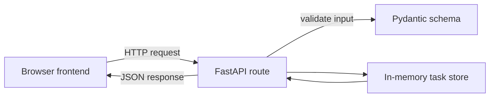

# Patient Task Management API

**Build 1 — Complete**

A small FastAPI app for keeping daily tasks and care reminders for different patient IDs. It includes a browser frontend served by the same FastAPI app.

## What you can do

- Choose any positive patient ID and load that patient's task list.
- Create a task with a title and optional due time.
- View task details, edit a task, mark it complete or incomplete, and delete it.
- Filter the list to show all tasks, tasks to do, or completed tasks.
- Use `/docs` to explore and call the API directly.

A medication reminder is stored as a task with a due time. This app records reminders; it does not send notifications or make treatment decisions.

## How the pieces connect



The frontend sends requests to the API using relative URLs, such as `/patients/42/tasks`. FastAPI serves both the frontend files and the API, so they share the same address. Read [Frontend and backend connection](frontend-backend-connection.md) for the request flow in more detail.

## Run the app

Run these commands from the repository root, where the shared `uv` environment lives:

```bash
uv sync
uv run fastapi dev 01_patienttasks/app/main.py
```

Then open:

- **App:** <http://127.0.0.1:8000/>
- **Interactive API docs:** <http://127.0.0.1:8000/docs>

Stop the server with `Ctrl+C`.

## API routes

| Method | Route | Purpose |
|---|---|---|
| `GET` | `/patients/{patient_id}/tasks` | List a patient's tasks; optionally filter with `?completed=true` or `?completed=false` |
| `POST` | `/patients/{patient_id}/tasks` | Create a task for that patient |
| `GET` | `/tasks/{task_id}` | Read one task |
| `PUT` | `/tasks/{task_id}` | Replace all editable task fields |
| `PATCH` | `/tasks/{task_id}` | Change only the fields included in the request |
| `DELETE` | `/tasks/{task_id}` | Delete a task |

Tasks contain an `id`, `patient_id`, `title`, optional `due_at`, and `completed` status. The app assigns the ID and patient ID; new tasks start with `completed: false`.

## Project files

```text
01_patienttasks/
├── app/
│   ├── main.py                 # Creates FastAPI and serves the frontend
│   ├── api/
│   │   └── tasks.py            # Declares task routes and HTTP behavior
│   ├── schemas/
│   │   └── task.py             # Validates input and shapes responses
│   └── storage/
│       └── task_store.py       # In-memory task data and CRUD helpers
├── frontend/
│   ├── index.html              # Page structure and forms
│   ├── styles.css              # Appearance and responsive layout
│   └── app.js                  # Calls the API and updates the page
├── tests/
│   └── test_tasks.py           # Automated checks for API behavior
├── assets/mindmaps/            # Visual concept maps used in the notes
├── fastapi-crud-and-validation.md      # Concepts behind this project
├── frontend-backend-connection.md      # How browser requests reach FastAPI
└── plan.md                     # Build plan and completion checklist
```

## Learning notes

- [FastAPI CRUD and validation](fastapi-crud-and-validation.md)
- [Frontend and backend connection](frontend-backend-connection.md)
- [Build plan](plan.md)

## Scope of this learning app

- Tasks are kept in memory and reset when the server stops.
- Patient IDs select separate demo task lists; they do not provide authentication or access control.
- There is no database, real reminder delivery, or clinical decision-making.

Run the API checks from the repository root with:

```bash
uv run pytest 01_patienttasks/tests
```
