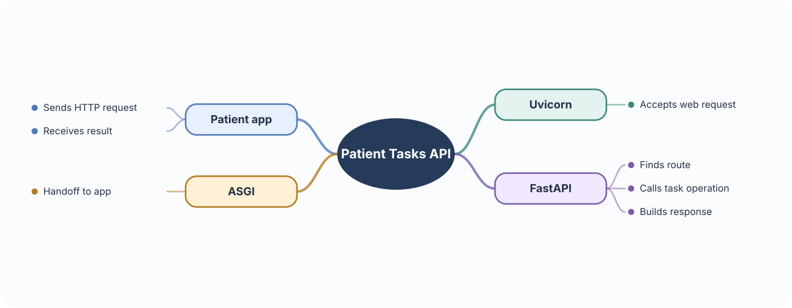
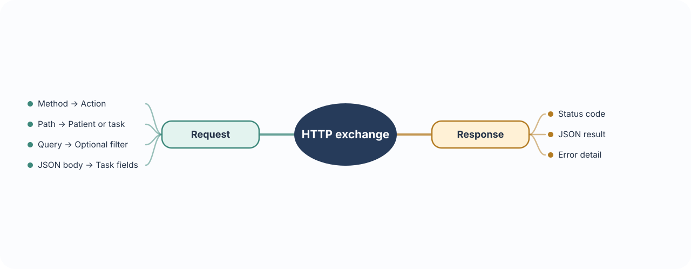
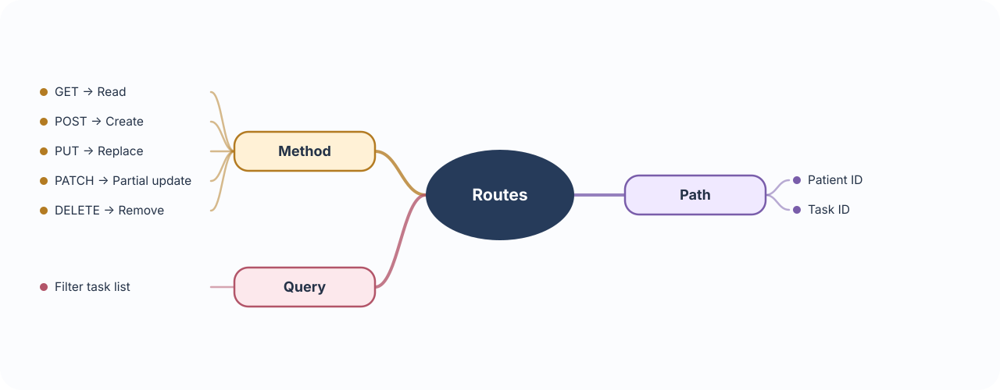
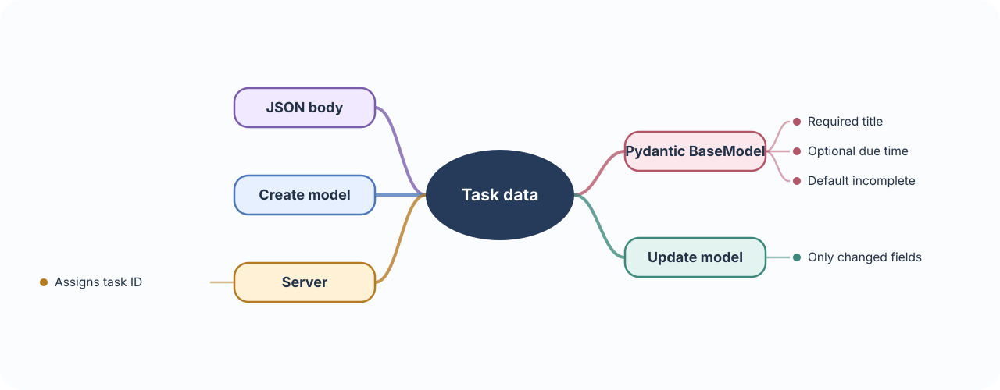
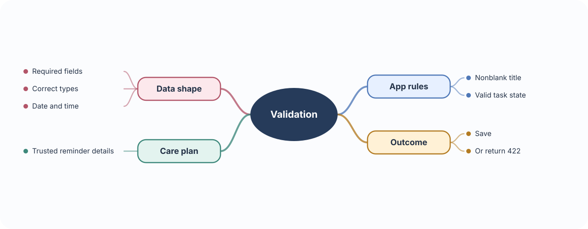
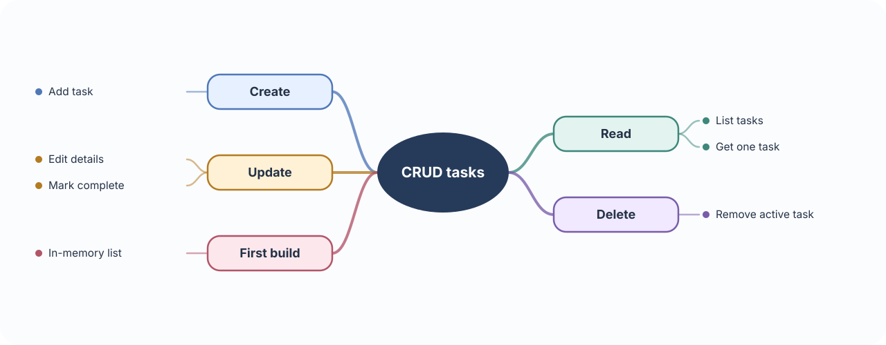
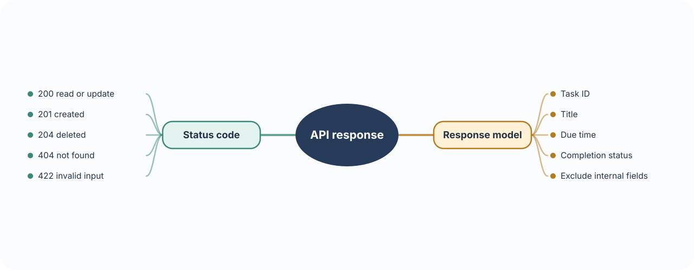
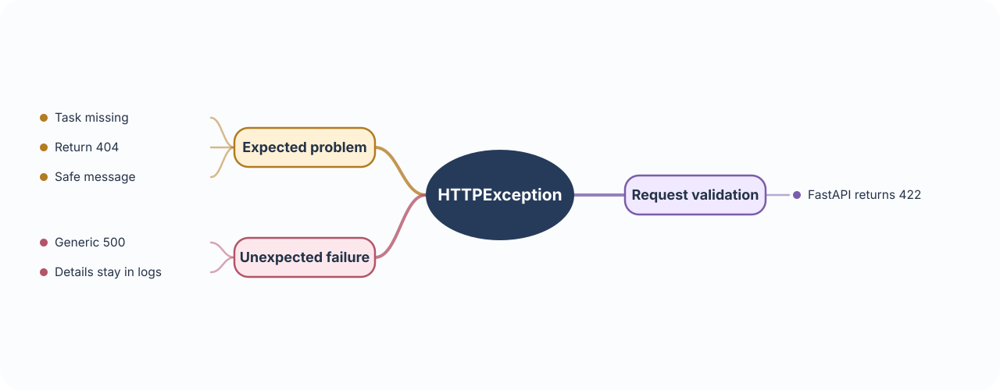

# 🩺 Build 01 · Patient Task Management API

> **Your build:** A backend where patients can add daily tasks and care-plan reminders, view them, update them, and track completion. The API stores reminder details; it does not choose treatment.

**The journey:** App → Request → FastAPI → Task action → Response

---

## ⚡ 01 · Start the API
### FastAPI · ASGI · Uvicorn

**🧠 Concept** — FastAPI is the Python framework for defining API operations. ASGI (Asynchronous Server Gateway Interface) is the handoff between the app and web server. Uvicorn is the server that receives HTTP requests and passes them to FastAPI.

**🩺 In Patient Tasks** — A “mark complete” request travels from the patient app to the task operation, then the result goes back to the app.

**🛠 Build it** — This project uses uv. FastAPI’s standard extra includes Uvicorn:

~~~sh
uv add "fastapi[standard]"
~~~

Create the FastAPI app in main.py:

~~~python
from fastapi import FastAPI

app = FastAPI()
~~~

Start the development server; it reloads after code changes. Open /docs to explore the API.

~~~sh
uv run fastapi dev main.py
~~~

---

## 🌐 02 · HTTP messages  
### Requests · responses · JSON

**🧠 Concept** — An HTTP request tells the server what action to take, which resource to use, and sometimes what data to use. A response reports what happened. JSON is a common format for request and response data.

**🩺 In Patient Tasks** — To add a task, the app sends a title and due time; the API replies with the saved task or an error.

**🛠 Build it** — Put create/update fields in a JSON body. For example:

~~~json
{
  "title": "Walk for 20 minutes",
  "due_at": null
}
~~~

| Request part | What it does | Example |
|---|---|---|
| Method | Names the action | POST |
| Path | Names the resource | /patients/42/tasks |
| Query | Filters a list | ?due=today |
| JSON body | Carries task fields | Title and due time |
| Response | Reports result | Status + saved task |

---

## 🧭 03 · Routes & HTTP methods  
### Send each action to the right operation

**🧠 Concept** — A route pairs a method with a path. FastAPI uses that pair to choose which operation runs.

**🩺 In Patient Tasks** — Use a patient ID in the path to find their list; use a task ID to update or remove one task. Use query values for optional filters.

**🛠 Build it**

| Method | Usual action | Patient Tasks |
|---|---|---|
| GET | Read | List tasks or fetch one |
| POST | Create | Add a task or reminder |
| PUT | Replace | Send the full task with changes |
| PATCH | Partially update | Change only completion status |
| DELETE | Remove | Remove from the active list |

Examples: GET /patients/42/tasks?due=today lists today’s tasks; PATCH /tasks/81 marks task 81 complete.

---

## 📦 04 · Pydantic BaseModel  
### Describe the data shape

**🧠 Concept** — A Pydantic BaseModel defines the fields and types expected in JSON. FastAPI parses JSON into that model so the operation receives structured data.

**🩺 In Patient Tasks** — A task has a title, may have a due time, and starts incomplete.

**🛠 Build it** — Use separate models for creating, updating, and returning tasks.

| Field | Create task | Update task |
|---|---|---|
| Title | Required text | Optional change |
| Due time | Optional date/time | Optional change |
| Completed | Defaults to false | Optional change |
| ID | Set by server | Never sent by app |

A field with a default can be omitted. A field that allows null can also be sent as JSON null. A PATCH model makes fields optional so the app can change just one field.

---

## ✅ 05 · Validation  
### Catch invalid data before saving

**🧠 Concept** — Validation checks that data has the right types and follows the app’s rules.

**🩺 In Patient Tasks** — Reject a blank title, an invalid date/time, or a completion value that is not true/false. Reminder details still need to come from the authorized care plan.

**🛠 Build it** — Let FastAPI/Pydantic catch missing or wrongly typed fields. Add simple task rules before changing data. Invalid request data returns 422.

---

## 🔁 06 · CRUD  
### Manage task records

**🧠 Concept** — CRUD means Create, Read, Update, Delete: the four basic operations on saved information.

**🩺 In Patient Tasks** — Create a task, show a task or list, edit or complete a task, and remove a task.

**🛠 Build it** — Connect each operation to a route. Use an in-memory list for this first exercise; it clears when the server restarts. Database persistence is covered in Build 2.

---

## 📤 07 · Response models & status codes  
### Return a predictable result

**🧠 Concept** — A response model defines which fields the API returns. A status code summarizes the outcome.

**🩺 In Patient Tasks** — Return the task ID, title, due time, and completion status. Keep internal fields out of the response.

**🛠 Build it** — Use one task response model for create/read/update results.

| Status | Meaning |
|---|---|
| 200 | Read or update succeeded |
| 201 | Task created |
| 204 | Task deleted; no body |
| 404 | Task not found |
| 422 | Request data invalid |

---

## 🚨 08 · HTTPException  
### Report expected errors

**🧠 Concept** — HTTPException stops an operation and returns a chosen status code with a short message.

**🩺 In Patient Tasks** — If task 81 does not exist, the update route should return 404 rather than pretending it worked.

**🛠 Build it** — Check for the task before updating or deleting. If it is missing, raise HTTPException with status 404 and a safe message. FastAPI already returns 422 for invalid request data; keep unexpected error details in server logs.

---

## 🧩 One request, end to end

When a patient marks a task complete:

1. Uvicorn receives the request and hands it to FastAPI through ASGI.
2. The route matches the method and task ID.
3. Pydantic parses the JSON; validation checks the fields.
4. CRUD updates the task.
5. The response model shapes the result; the status code reports success.
6. If the task is missing, HTTPException returns 404.

~~~mermaid
---
config:
  theme: neutral
  look: classic
---
flowchart LR
  A[Patient app] --> B[Uvicorn]
  B -->|ASGI| C[FastAPI route]
  C --> D[JSON and Pydantic]
  D --> E[Validation]
  E -->|valid| F[CRUD update]
  F --> G[Response model and status]
  G --> H[Patient app]
  E -->|invalid| I[422 error]
  C -->|task missing| J[HTTPException 404]
~~~

### 📚 Official references

- **FastAPI:** [first steps](https://fastapi.tiangolo.com/tutorial/first-steps/) · [request bodies](https://fastapi.tiangolo.com/tutorial/body/) · [path and query parameters](https://fastapi.tiangolo.com/tutorial/query-params/) · [response models](https://fastapi.tiangolo.com/tutorial/response-model/) · [errors](https://fastapi.tiangolo.com/tutorial/handling-errors/)
- **Runtime:** [ASGI specification](https://asgi.readthedocs.io/en/latest/specs/main.html) · [Uvicorn](https://www.uvicorn.org/)
