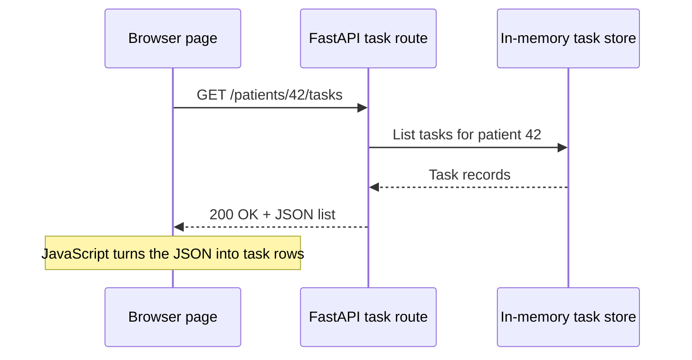
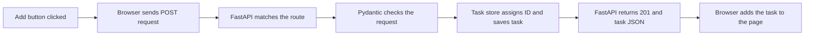

# How the Frontend Connects to the FastAPI Backend

> **The simple idea:** The browser sends an HTTP request to FastAPI. FastAPI works with the task store and sends back a response. The browser uses that response to update the page.

## The parts

```text
Browser page                         FastAPI backend
┌──────────────────────┐             ┌──────────────────────┐
│ index.html           │             │ app/main.py          │
│ styles.css           │             │ starts the app       │
│ app.js               │── requests ─▶│                      │
│ shows tasks          │◀─ responses ─│ api/tasks.py         │
└──────────────────────┘             │ schemas/task.py      │
                                     │ storage/task_store.py│
                                     └──────────────────────┘
```

- **Browser page:** Shows the task form and task list. JavaScript sends requests with the browser’s `fetch()` feature.
- **`app/main.py`:** Starts FastAPI and connects the task routes.
- **`app/api/tasks.py`:** Receives each request and chooses the matching operation.
- **`app/schemas/task.py`:** Pydantic checks incoming task data and shapes returned task data.
- **`app/storage/task_store.py`:** Reads or changes the in-memory tasks.

The browser never reaches into Python files or the task dictionary. It communicates through the API’s URLs and HTTP messages.

## Example: loading the task list

When the page opens, the browser asks FastAPI for the selected patient’s tasks. The page starts with ID `42`, and the patient ID control can load another positive ID:



If there are no tasks, the API returns an empty list, and the page can show “No tasks yet.”

## Example: adding a task

The person enters a title and presses **Add**. The browser sends:

```http
POST /patients/42/tasks
Content-Type: application/json
```

```json
{
  "title": "Walk for 20 minutes",
  "due_at": null
}
```

FastAPI follows this path:



The response includes values the server supplies:

```json
{
  "id": 1,
  "patient_id": 42,
  "title": "Walk for 20 minutes",
  "due_at": null,
  "completed": false
}
```

The browser can display this response immediately. It does not guess the task ID or completion status.

## What each button asks the API to do

| Page action | Request | What the API does |
|---|---|---|
| Choose a patient ID | `GET /patients/{patient_id}/tasks` | Returns that ID’s task list |
| Filter All, To do, or Done | `GET /patients/{patient_id}/tasks?completed=true/false` | Filters the list in FastAPI |
| Add a task | `POST /patients/{patient_id}/tasks` | Validates and creates a task |
| Open Details or Edit | `GET /tasks/{task_id}` | Returns the current task, or `404` if missing |
| Mark a task complete | `PATCH /tasks/{task_id}` with `{"completed": true}` | Changes only the completion value |
| Save the Edit form | `PUT /tasks/{task_id}` with title, due time, and completion value | Replaces all editable task fields |
| Delete a task | `DELETE /tasks/{task_id}` | Removes the task and returns `204` with no body |

The browser checks the response status. For example, `422` means the request data needs correcting, and `404` means the task ID was not found. A delete response has no JSON body, so the browser should remove the row without trying to parse a response object.

## Where the frontend will appear

For the local demo, FastAPI can serve the page at `/`, while the existing API routes continue to handle `/patients/...` and `/tasks/...`. The browser and API then share the same address, so CORS setup is unnecessary. FastAPI checks API routes before its frontend fallback. [FastAPI frontend guide](https://fastapi.tiangolo.com/tutorial/frontend/) · [FastAPI CORS guide](https://fastapi.tiangolo.com/tutorial/cors/)

If the frontend later runs on a separate development server or port, the browser treats it as a different origin. Then we would configure an explicit allowed origin in FastAPI or use a development proxy.

## Scope of this demo

- Choose any positive demo patient ID and use made-up task data. Each ID has a separate task list.
- The current store is in memory, so restarting FastAPI clears tasks.
- This API has no sign-in or patient ownership checks yet. The demo is not for real patient information or public use.
