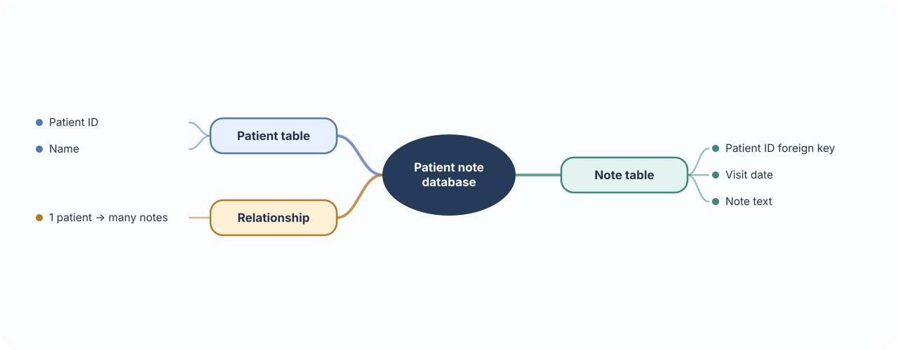
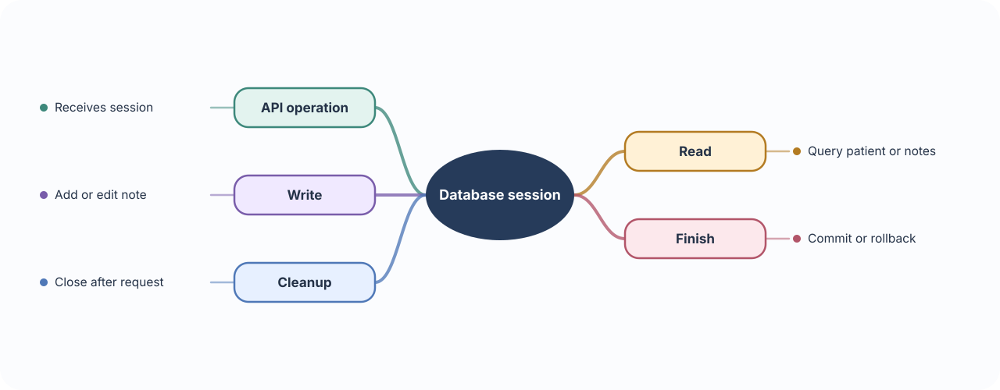
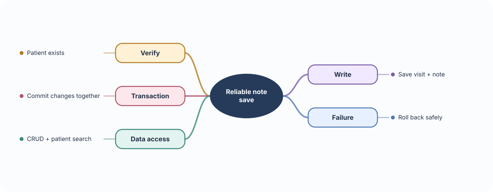
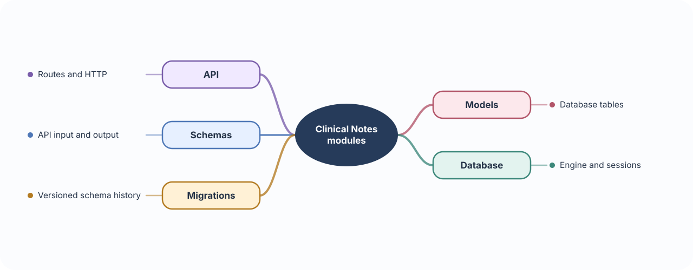

# 🩺 Build 02 · Clinical Notes Backend

> **Your build:** A doctor creates and edits notes for a patient, searches them, and reviews visit history. Notes are sensitive records, so each note must stay connected to the correct patient and be shown only to authorized users.

**The journey:** Patient → Visit → Note → Search/history

---

## 🗃️ 01 · PostgreSQL & SQL  
### Give notes a reliable home

**🧠 Concept**

- **Database:** A place for an application’s data to persist after the API restarts.
- **Relational database:** Stores data in tables made of rows and columns. A row is one record; a column is one kind of value, such as a patient name.
- **Primary key:** A unique ID for one row. The ID lets the application refer to that patient or note without confusing two people with the same name.
- **PostgreSQL:** The database server that stores these tables and applies rules to them.
- **SQL:** The language used to create tables and query or change rows.

**⚠️ Important to remember**

- A database is the durable source of truth; an in-memory Python list disappears when the process stops.
- Prefer stable IDs for relationships. Names and dates can repeat or change, so they are poor substitutes for record IDs.

**🩺 In Clinical Notes**

- Keep patients in a `patients` table and visit notes in a `notes` table.
- A note belongs to one patient, while one patient can have many notes. The note stores the patient’s ID to connect the records.

**🛠 Build it**

- Create patient and note tables with clear columns and primary keys.
- Put the patient ID on each note, then query notes by patient, visit date, or search text.
- Add database constraints so a note cannot point to a patient that does not exist.

---

## 🧱 02 · SQLAlchemy, SQLModel & sessions  
### Work with database rows in Python

**🧠 Concept**

- **ORM:** An Object-Relational Mapper connects database rows and tables to Python objects and classes. It saves us from writing raw SQL for every common operation, but SQL still runs underneath.
- **SQLAlchemy:** The main Python toolkit used here to define mappings, build queries, and manage sessions.
- **Session:** A short-lived workspace for database work. It loads rows, tracks changes, and commits or rolls them back.
- **SQLModel:** A higher-level option built on SQLAlchemy and Pydantic. It uses Python type annotations for validation and database mapping.

**⚠️ Important to remember**

- Creating or changing a Python object does not necessarily save it. The session must commit the database transaction.
- A session is not a global shared object. Give each request its own session and close it when the request ends.

**🩺 In Clinical Notes**

- A `Patient` object and a `Note` object represent rows in their corresponding tables.
- The API creates notes through a session and uses queries to find a patient’s history.

**🛠 Build it**

- Learn the SQLAlchemy model, query, and session flow first.
- Use a session to query or change rows; commit successful changes and close the session after the request.
- Try SQLModel as a concise way to define models. Keep request/response models distinct when the API needs different fields.

---

## 🔗 03 · Relationships, CRUD & transactions  
### Keep patient history consistent

**🧠 Concept**

- **Foreign key:** A database column that points to a row in another table. It lets the database check that a related record exists.
- **ORM relationship:** A Python-friendly way to navigate linked records, such as `patient.notes`. It uses the foreign key underneath.
- **CRUD:** Create, read, update, and delete records through queries and database operations.
- **Transaction:** A group of database changes treated as one unit. It commits all changes together, or rolls them all back if a step fails.

**⚠️ Important to remember**

- Checking for a patient in application code is not enough to prevent every invalid link; keep the foreign key constraint in the database too.
- Use one transaction for changes that must succeed together. Keep it short and do not wait for a slow external service while holding it open.

**🩺 In Clinical Notes**

- Every note must belong to a real patient.
- If creating a visit requires multiple related rows, save them in one transaction so an error does not leave only half the visit behind.

**🛠 Build it**

- Link each note to a patient with a foreign key.
- Implement create, read, update, and delete using database queries.
- Search notes through the patient relationship.
- Use a transaction when one user action changes multiple related rows.

---

## 🧰 04 · Dependency injection, Alembic & project structure  
### Keep the backend maintainable

**🧠 Concept**

- **Dependency injection:** A way to provide a route with something it needs, such as a database session, instead of making the route create and manage it itself.
- **FastAPI `Depends`:** Declares that requirement. A dependency can open a session for the request and reliably close it afterward.
- **Project structure:** Keeps routes, schemas, database setup, and business logic in separate modules so each part has a clear job.
- **Alembic migration:** A versioned set of database changes, such as adding a column. Migrations let an existing database move from one schema version to the next.

**⚠️ Important to remember**

- Editing a Python model does not change an existing database table. Create and apply a migration for schema changes.
- Do not log clinical note content. Logs help investigate failures, but they can also become an unintended copy of sensitive records.

**🩺 In Clinical Notes**

- Each request needs a database session that is closed even if the route fails.
- As patient and note tables evolve, Alembic gives existing databases a controlled upgrade path.

**🛠 Build it**

- Use FastAPI `Depends()` to provide and close a session per request.
- Put routes, database models, request/response schemas, and database setup in separate modules.
- Create an Alembic migration for each schema change; practice applying and reverting one.
- Keep clinical content out of routine logs.

### 📚 Official references

- [PostgreSQL tutorial](https://www.postgresql.org/docs/current/tutorial.html)
- [SQLAlchemy ORM quick start](https://docs.sqlalchemy.org/en/20/orm/quickstart.html) · [Sessions](https://docs.sqlalchemy.org/en/20/orm/session_basics.html)
- [SQLModel tutorial](https://sqlmodel.tiangolo.com/tutorial/) · [Alembic tutorial](https://alembic.sqlalchemy.org/en/latest/tutorial.html)
