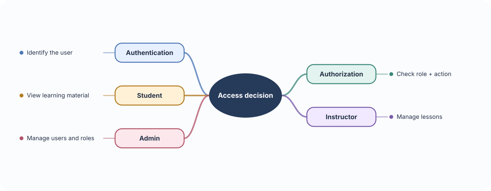
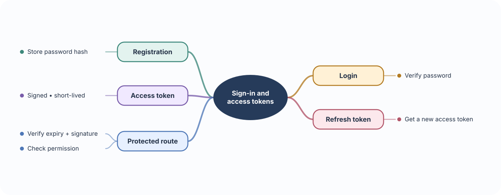
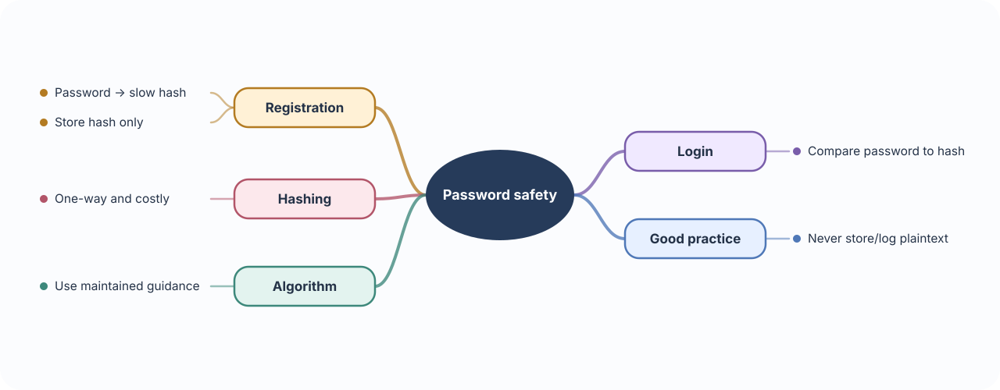
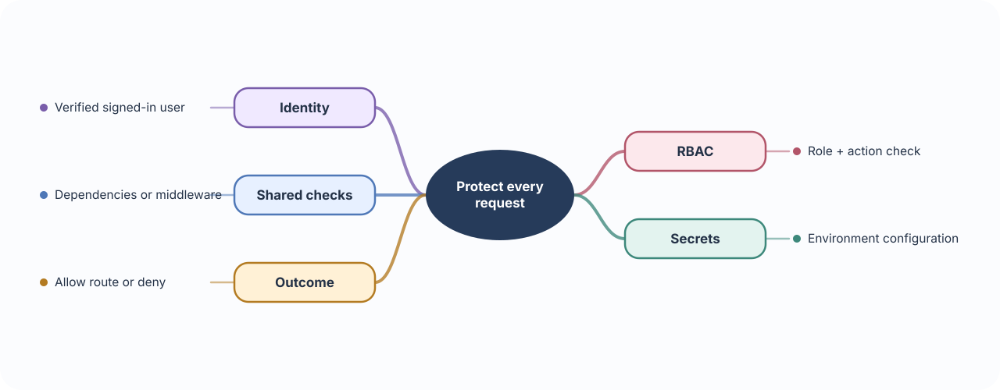

# 🔐 Build 03 · Medical Education Auth Platform

> **Your build:** Students, instructors, and admins can register and sign in. The API checks who they are and what each role is allowed to do.

**The journey:** Register → verify password → sign in → receive token → access allowed routes

---

## 🪪 01 · Authentication vs authorization

**🧠 Concept** — Authentication asks “Who are you?” Authorization asks “What may you do?” Logging in proves identity; checking a role decides whether the user may create a course or manage accounts.

**🩺 In this platform** — A student can view learning material; an instructor can manage lessons; an admin can manage users and roles.

**🛠 Build it** — Define student, instructor, and admin roles. For each protected operation, check the signed-in user's role on the server. Hiding a button in the user interface is not permission enforcement.

---

## 🎟️ 02 · OAuth2 & JWT  
### Sign in and carry access

**🧠 Concept** — OAuth2 is an authorization framework for granting limited access. A JWT is a compact, signed token that carries claims, such as a user ID and expiry time. A signature lets the API detect changes; a normal signed JWT is not encrypted.

**🩺 In this platform** — After sign-in, the client sends an access token with later requests. FastAPI can verify it and identify the user.

**🛠 Build it**

- Registration stores a password hash. Login verifies the password, then issues tokens.
- Use an OAuth2 bearer-token flow for protected requests. OpenID Connect adds a standard identity layer to OAuth2 when needed.
- Keep access tokens short-lived. Use a refresh token only to obtain a new access token; protect and rotate/revoke refresh tokens.
- Put only necessary claims in a JWT. Verify its signature and expiry; do not put passwords, secrets, or sensitive student data in it.

---

## 🧂 03 · Password hashing  
### Never save a readable password

**🧠 Concept** — A password hash is a one-way result used to check a password later. Unlike encryption, it is not meant to be reversed. A slow password-hashing algorithm makes bulk guessing more expensive.

**🩺 In this platform** — Registration stores a password hash. Login compares the submitted password with that hash, then issues a token if it matches.

**🛠 Build it** — Use a maintained password-hashing library and its recommended settings; never store or log plain passwords. The syllabus names bcrypt; review current algorithm guidance before choosing it for a new production system.

---

## 🧱 04 · RBAC, middleware & secrets  
### Apply security consistently

**🧠 Concept** — Role-based access control (RBAC) assigns permissions to roles. Middleware is shared code that runs around requests, useful for common checks and request context. Secrets are credentials that must stay outside source code.

**🩺 In this platform** — A protected course-management route can require instructor or admin role, while a student route allows student access.

**🛠 Build it**

- Write a role/action table before adding protected routes.
- Put reusable sign-in and role checks into dependencies or middleware.
- Load signing keys and database credentials from environment configuration.
- Keep local secrets out of Git; rotate exposed keys.

### 📚 Official references

- [FastAPI OAuth2, JWT, and password hashing](https://fastapi.tiangolo.com/tutorial/security/oauth2-jwt/)
- [OAuth 2.0 specification](https://datatracker.ietf.org/doc/html/rfc6749) · [JWT specification](https://datatracker.ietf.org/doc/html/rfc7519)
- [OWASP password storage guidance](https://cheatsheetseries.owasp.org/cheatsheets/Password_Storage_Cheat_Sheet.html)
