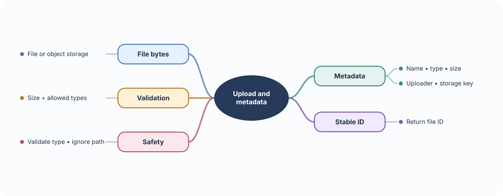
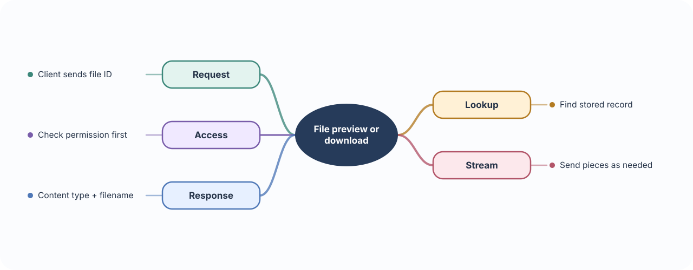
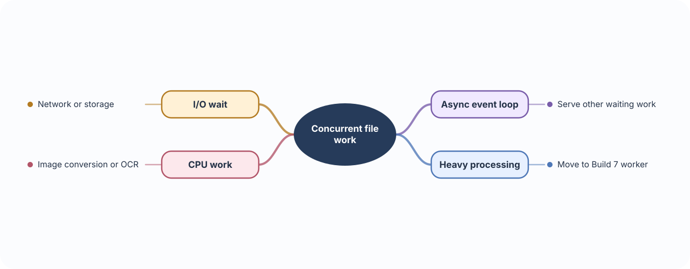
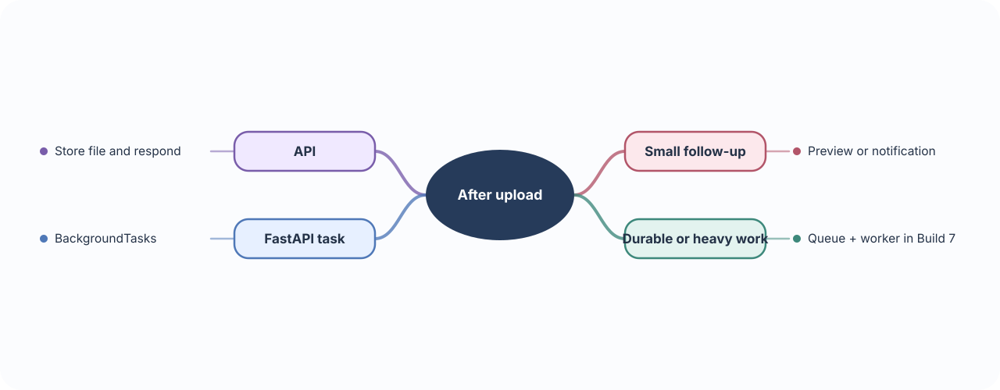

# 📚 Build 04 · Medical Content Upload API

> **Your build:** Medical colleges can upload PDFs, slides, and medical images, save metadata, preview or download files, and start processing.

**The journey:** Upload → validate → store file + metadata → preview or process

---

## 📎 01 · File uploads & metadata

**🧠 Concept**

- **Multipart form data:** An HTTP format that can send file bytes and ordinary fields, such as a title, in one request.
- **File bytes:** The actual contents of the PDF, slide deck, or image. Large files should be handled without loading the entire file into application memory.
- **Metadata:** Facts that describe the file, such as its display name, size, media type, uploader, and storage key. Metadata helps the app find and manage the file; it is not the file itself.
- **`UploadFile`:** FastAPI’s upload interface, which exposes file information and lets the application read the content.

**⚠️ Important to remember**

- A filename and `Content-Type` arrive from the client, so neither proves a file is safe or truly has that format. Check size and inspect/validate content as appropriate.
- Store files under server-generated keys, not a path built from the submitted filename. This avoids filename collisions and path-traversal risks.

**🩺 In this API**

- A lecture PDF or medical image needs a stable record so a college can find it and request a preview later.
- Store the content in file/object storage and the metadata in the database, linked by a file ID or storage key.

**🛠 Build it**

- Receive uploads with FastAPI’s `UploadFile`.
- Enforce size limits and allowed media types; do not trust the filename or client-provided content type alone.
- Save the file in file/object storage and save its metadata separately.
- Return a stable file ID, not a server filesystem path.

---

## 🌊 02 · Streaming downloads & previews

**🧠 Concept**

- **Normal file response:** The server may need the whole file ready before sending it, which can use a lot of memory for large content.
- **Streaming:** Sends or reads the file in smaller pieces. The app can start receiving data before the entire file has been sent.
- Streaming is especially useful for large PDFs, images, or generated content; it does not decide who is allowed to access the file.

**⚠️ Important to remember**

- Check that the signed-in user may access the file before starting the stream. A hard-to-guess file ID is not an authorization check.
- A stream can fail after some bytes have been sent. At that point the API cannot replace the partial response with a fresh JSON error.

**🩺 In this API**

- A user previews a lecture PDF or downloads a stored slide deck.
- The API finds the file by its ID, checks access, then streams the content with a useful content type and download name.

**🛠 Build it**

- Look up the file by ID and confirm access before sending any content.
- Use FastAPI’s `StreamingResponse` or `FileResponse` with the correct content type and download name.
- Do not expose a raw local path.

---

## ⏳ 03 · Sync, async, event loop & concurrency

**🧠 Concept**

- **Synchronous code:** Waits for an operation to finish before moving to the next line.
- **Asynchronous code:** Can pause at an `await` while waiting for network, database, or file I/O, letting the event loop work on another request.
- **Concurrency:** Managing several operations that are in progress at once. It improves use of time spent waiting; it does not make CPU-heavy work run faster by itself.
- **CPU-heavy work:** OCR or image conversion keeps the processor busy rather than waiting. It usually belongs in a separate worker process.

**⚠️ Important to remember**

- `async def` is only helpful when slow I/O uses async-compatible libraries. A blocking library call inside an async route can stall the event loop.
- Concurrency is not the same as parallel processing. Use workers or other process-level tools for substantial CPU work.

**🩺 In this API**

- Uploads and remote storage may involve waiting for I/O.
- Image conversion and OCR can take significant CPU time and should not hold up normal API requests.

**🛠 Build it**

- Use async endpoints with libraries that support `await`.
- Avoid blocking the event loop with slow synchronous work; move heavier processing to a worker in Build 7.

---

## ⚙️ 04 · Background tasks

**🧠 Concept**

- **Background task:** Work started after the API sends its response, so the user does not wait for a small follow-up action to finish.
- The original response means the request was accepted; it does not mean the background work has completed successfully.
- FastAPI `BackgroundTasks` runs lightweight work in the application process.

**⚠️ Important to remember**

- In-process background tasks are not a durable job system. If the process stops, queued work may be lost; there is no built-in retry or job status.
- Use a queue and worker for long, CPU-heavy, retryable, or business-critical jobs. Return a job ID and let the client check progress.

**🩺 In this API**

- After storing a file, the API can schedule a lightweight notification or preview task.
- For document extraction that may take minutes, return a job ID and let a worker report its status.

**🛠 Build it**

- Use FastAPI `BackgroundTasks` for small, short follow-up work.
- Use a queue and worker, as in Build 7, for durable, CPU-heavy, or retryable processing.

### 📚 Official references

- [FastAPI file uploads](https://fastapi.tiangolo.com/tutorial/request-files/)
- [FastAPI streaming and file responses](https://fastapi.tiangolo.com/advanced/custom-response/)
- [FastAPI background tasks](https://fastapi.tiangolo.com/tutorial/background-tasks/)
- [FastAPI async and await](https://fastapi.tiangolo.com/async/)
