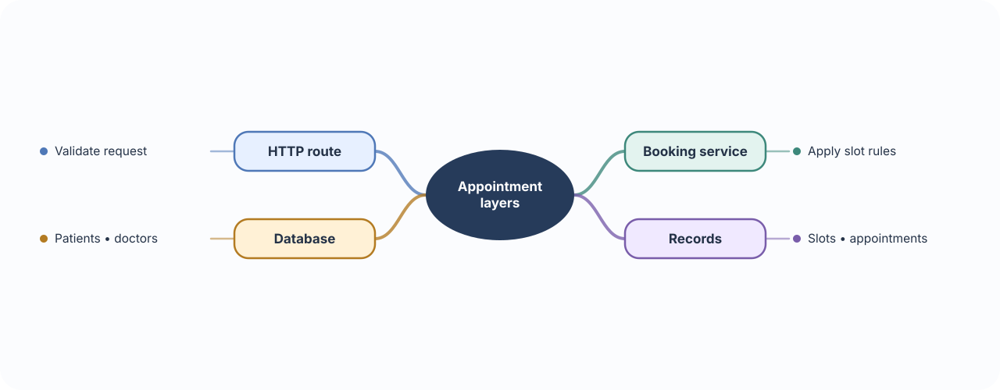
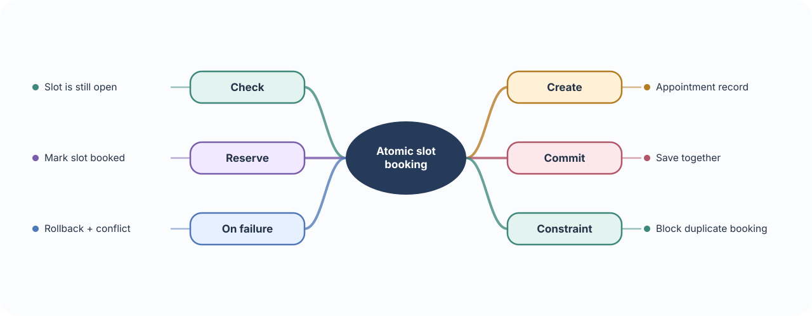
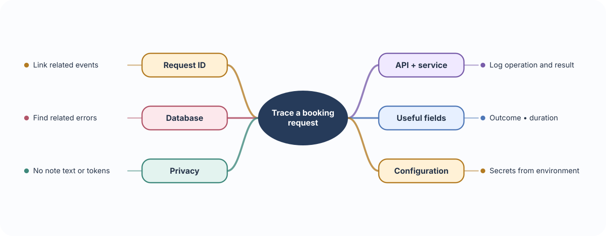
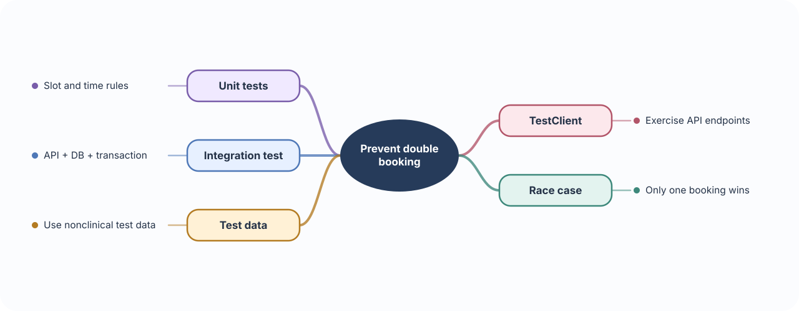

# 📅 Build 05 · Healthcare Appointment Backend

> **Your build:** Patients find a doctor’s open time slot, book it, and review visit history. The system must prevent two patients from booking the same slot.

**The journey:** Find slot → request booking → confirm once → record visit

---

## 🧱 01 · Project structure & service layer

**🧠 Concept**

- **Route:** Handles the HTTP boundary: receives validated input and returns an HTTP response.
- **Service layer:** Holds application decisions and workflows, such as deciding whether a slot can be booked.
- **Models and database layer:** Describe stored records and perform database work.
- **Schemas:** Describe the input and output shape the API accepts and returns.
- **Configuration:** Holds values that change by environment, such as a database URL, outside the business rules.

**⚠️ Important to remember**

- A service layer helps when a workflow has rules or several steps; a tiny endpoint may not need extra layers. Keep the route thin once logic becomes reusable or involved.
- Separation is useful only when each module has a clear job. Splitting files without clear responsibilities can make navigation harder, not easier.

**🩺 In Appointments**

- Booking involves patients, doctors, slots, and appointments.
- The route receives the request; a booking service applies availability rules; the database layer saves the appointment.

**🛠 Build it**

- Organize responsibilities into modules such as `api/`, `services/`, `models/`, `schemas/`, `db/`, and `config/`.
- Keep the route focused: validate the request, call the booking service, and return its result.

---

## 🔒 02 · Transactions & scheduling

**🧠 Concept**

- **Transaction:** Groups database changes as one unit. If all steps work, commit them; if a step fails, roll them back so the database is not left half-updated.
- **Race condition:** Two requests can arrive at almost the same time and both see a slot as open before either saves its booking.
- **Database constraint:** A rule in the database that rejects conflicting bookings even if two requests race.
- **Time zone:** A rule that converts a stored moment into local clock time. Regions change offsets, including daylight-saving changes.

**⚠️ Important to remember**

- Checking availability in Python alone is not enough: two requests can pass the check at once. The database must enforce the no-double-booking rule.
- Store appointment moments consistently, usually as UTC instants, and retain the clinic’s time zone for display and local scheduling rules.

**🩺 In Appointments**

- Check a slot and create its appointment as one transaction.
- Without a database constraint and transaction, two patients could both book the same open slot.

**🛠 Build it**

- Store a clear start/end time and the relevant time zone.
- Enforce a database constraint that prevents duplicate active bookings for the same slot.
- In one transaction, verify availability, create the appointment, and mark the slot booked.
- If the operation fails, roll it back and return a conflict.

---

## 🧾 03 · Configuration, logging & request IDs

**🧠 Concept**

- **Configuration:** Values that differ between local, test, and production environments, such as database URLs and feature settings.
- **Structured log:** An event stored as named fields, such as action, outcome, duration, and request ID, so tools can search and group it.
- **Request ID:** A unique label attached to a request and its log entries so one booking attempt can be followed through the system.

**⚠️ Important to remember**

- A request ID helps trace a request; it is not a password or proof of identity. Do not use it to grant access.
- Logs can leak sensitive data. Record operational facts, not clinical note content, access tokens, or full request bodies.

**🩺 In Appointments**

- When a booking fails, staff can search by request ID and see which operation failed and how long it took.
- The logs should help investigate the problem without recording patient details.

**🛠 Build it**

- Keep database URLs and secrets in environment configuration.
- Log a request ID, operation, outcome, and timing.
- Avoid logging clinical note content, access tokens, or full patient data.

---

## 🧪 04 · Tests — pytest & TestClient

**🧠 Concept**

- **Unit test:** Checks one small piece of logic in isolation, such as whether a time slot is considered available.
- **Integration test:** Checks connected parts together, such as a request passing through FastAPI and updating a test database.
- **pytest:** Finds and runs Python tests, and provides fixtures for shared setup and cleanup.
- **FastAPI `TestClient`:** Sends test HTTP requests to the application without starting a real browser or server.

**⚠️ Important to remember**

- A test that checks the happy path does not prove race conditions are safe. Test two booking attempts for one slot and verify the database accepts only one.
- Use isolated test data and a test database. Never run tests against real patient records or a production database.

**🩺 In Appointments**

- Test the booking rules and the full request path.
- The key behavior is that only one of two attempts to book the same slot succeeds.

**🛠 Build it**

- Unit-test slot availability and time-zone rules.
- Use `TestClient` to test create, read, update, and booking endpoints.
- Integration-test two booking attempts for the same slot; only one should succeed.
- Keep test data separate from real patient information.

### 📚 Official references

- [FastAPI project testing](https://fastapi.tiangolo.com/tutorial/testing/)
- [pytest getting started](https://docs.pytest.org/en/stable/getting-started.html)
- [SQLAlchemy sessions and transactions](https://docs.sqlalchemy.org/en/20/orm/session_basics.html)
