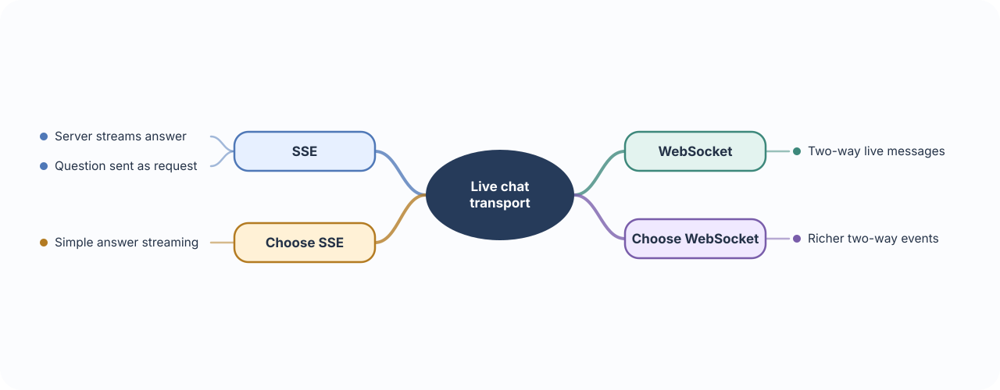
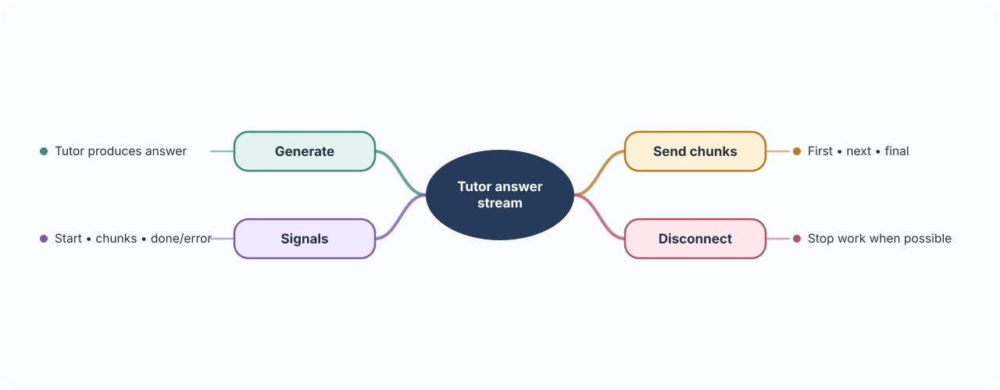
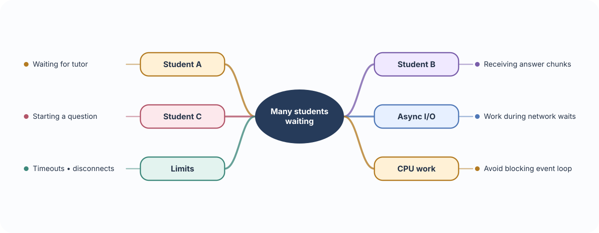
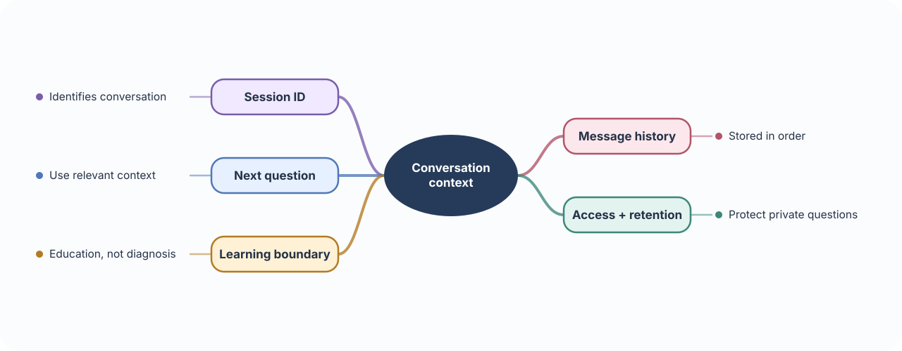

# 💬 Build 06 · Medical Tutor Chat Backend

> **Your build:** A student asks a medical-learning question and receives an answer as it is generated. The API keeps the chat session and message history.

**The journey:** Student question → tutor service → answer streams back → conversation is saved

---

## 🔌 01 · WebSockets vs SSE

**🧠 Concept**

- **WebSocket:** Keeps a connection open so the client and server can both send messages over it.
- **Server-Sent Events (SSE):** Streams events from the server to the client over HTTP. The client cannot send messages back on that same stream.
- Choose the transport that matches the conversation. A one-way answer stream is simpler with SSE; interactive two-way messages may need WebSockets.

**⚠️ Important to remember**

- SSE only streams server → client. Send the question through a separate HTTP request, then stream the answer; use WebSockets when both sides need live messages on one connection.
- A long-lived connection still needs access checks, timeouts, and a plan for disconnects and reconnects.

**🩺 In Medical Tutor**

- The student sends a question, then watches the tutor’s answer arrive piece by piece.
- The student can send a follow-up as a new request with SSE or through the open WebSocket connection.

**🛠 Build it**

- Use **SSE** when the main need is streaming answer text to the student.
- Use **WebSockets** when both sides need live messages through one persistent connection.
- Start with SSE for a simple request-and-stream chat; use WebSockets if the product needs richer two-way events.

---

## 🌊 02 · Streaming responses

**🧠 Concept**

- **Normal response:** The server waits for the complete answer, then sends it all at once.
- **Streaming response:** The server sends pieces as they become available, so the student sees progress sooner.
- **Chunk:** One piece of the answer. Chunks may split words or sentences, so the client joins them into the displayed answer.
- A stream needs a clear way to signal completion and errors, and it should stop work when the client disconnects.

**⚠️ Important to remember**

- Once streaming starts, the HTTP status and headers have already been sent. Later failures need an error event or an interrupted stream, not a new HTTP error response.
- A partial answer is not automatically a complete or safe answer. Clearly signal whether generation finished or failed.

**🩺 In Medical Tutor**

- The student sees the answer appear progressively instead of waiting for the entire response.
- The client can display a loading state until the stream sends its completion signal.

**🛠 Build it**

- Connect the tutor’s output stream to FastAPI’s `StreamingResponse` or SSE support.
- Send clear start, content, completion, and error events.
- Stop generation when the client disconnects.

---

## ⚡ 03 · Async & concurrency

**🧠 Concept**

- **I/O wait:** Time spent waiting for another system, such as the model provider or database, to respond.
- **`async` / `await`:** Lets the event loop pause a request during compatible I/O and work on another request meanwhile.
- **Concurrency:** Several requests make progress during overlapping waits. This can improve throughput, but does not make CPU-heavy work run faster.
- **CPU-heavy work:** Computation such as large document processing; move it to a worker rather than blocking the event loop.

**⚠️ Important to remember**

- Writing an endpoint with `async def` does not make blocking libraries asynchronous. Use async-capable clients or move the blocking work out of the event loop.
- Concurrency is not unlimited capacity. Add request limits, timeouts, cancellation handling, and respect the model provider’s rate limits.

**🩺 In Medical Tutor**

- Many students may be waiting for model responses at the same time.
- While one request waits on the model provider, the server should still make progress on other requests.

**🛠 Build it**

- Use async-compatible model and network clients.
- Set timeouts and concurrency limits, handle disconnects, and avoid blocking the event loop with slow synchronous work.

---

## 🗂️ 04 · Sessions & message history

**🧠 Concept**

- **Session:** An ID and record that group messages into one conversation.
- **History:** Earlier user and assistant messages included as context for a follow-up.
- The model does not automatically know previous turns. The app must send the relevant history or use a provider feature that stores it.
- Long history uses more context and may increase cost or slow responses, so the app needs a limit or summary strategy.

**⚠️ Important to remember**

- A session ID is not proof of ownership. Check that the signed-in student is allowed to read or continue that session.
- Keep access and retention rules for message history; a student’s question may contain sensitive personal information.

**🩺 In Medical Tutor**

- A follow-up like “why?” makes sense only when connected to the student’s previous question and the tutor’s answer.
- Keep educational explanations clearly separate from clinical diagnosis or treatment advice.

**🛠 Build it**

- Give each conversation a session ID and store messages in order.
- Verify the user may access the session; send only relevant history to the tutor.
- Set retention and access rules because questions may contain sensitive information.
- Keep educational answers clearly separate from clinical diagnosis.

### 📚 Official references

- [FastAPI WebSockets](https://fastapi.tiangolo.com/advanced/websockets/)
- [FastAPI Server-Sent Events](https://fastapi.tiangolo.com/tutorial/server-sent-events/)
- [FastAPI streaming responses](https://fastapi.tiangolo.com/advanced/custom-response/)
- [FastAPI async and await](https://fastapi.tiangolo.com/async/)
