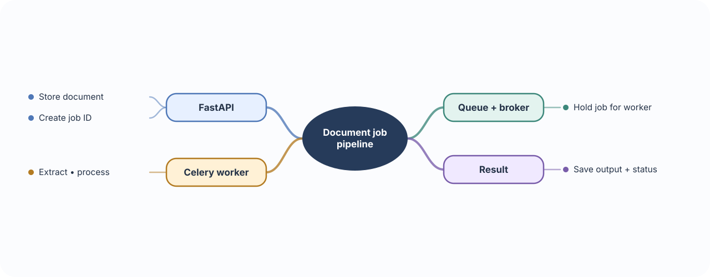
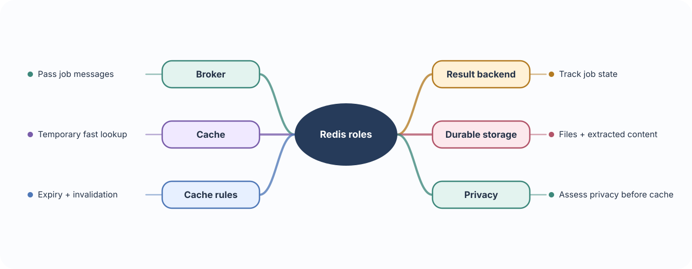
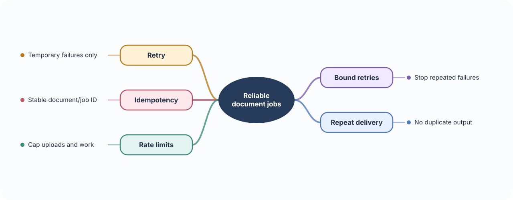

# 🏭 Build 07 · Medical Document Processing Pipeline

> **Your build:** Upload lecture PDFs, guidelines, or notes; extract useful content; process it in the background; and store the result.

**The journey:** Upload → queue → worker → extract/process → save result

---

## 📨 01 · Queues, Celery & workers

**🧠 Concept**

- **Job:** A description of work to do, such as “extract text from document 123.”
- **Queue:** A waiting area that holds jobs until a worker can process them.
- **Broker:** The messaging service Celery uses to deliver jobs to workers.
- **Worker:** A separate process that takes a job and performs the slow work.
- The API can save the document, enqueue a job, return a job ID, and stay available while the worker continues.

**⚠️ Important to remember**

- Put a small reference such as a document ID in the job, not the whole PDF. Workers can load the file from storage when they need it.
- A job may run again after a timeout or worker restart. Make processing safe to repeat and track status in durable storage.

**🩺 In the pipeline**

- A PDF upload should not keep the student waiting while text extraction and processing run.
- The API returns the job ID; the student can later ask whether processing is queued, running, complete, or failed.

**🛠 Build it**

- Store the document and create a job containing its document ID.
- Return a job ID immediately so the client can check progress.
- A Celery worker processes the document and records status and result in durable storage.

---

## 🧰 02 · Redis: broker, results & cache

**🧠 Concept**

- **Redis:** A fast service that stores values using data structures such as strings, lists, and sets.
- **Broker:** Redis can pass Celery job messages from the API to workers.
- **Result backend:** Redis can hold job state or results so the app can check progress.
- **Cache:** Redis can temporarily keep a result that is expensive to fetch or calculate again.
- These are separate uses; the team chooses what data belongs in Redis and how long it should stay there.

**⚠️ Important to remember**

- Redis should not be the only copy of an important document or clinical result. Use durable file and database storage as the source of truth.
- A cache can expire or be evicted. Give entries a lifetime and define how updates invalidate stale values; do not cache sensitive content without a privacy plan.

**🩺 In the pipeline**

- The app can ask whether a document job is queued, running, complete, or failed.
- Repeated metadata lookups may be cached for a short time; the original document and final extracted content remain in durable storage.

**🛠 Build it**

- Keep document files and durable extracted content in file/database storage.
- Use Redis for messages, job state, or deliberately chosen cache entries.
- Give cached values a lifetime and define how updates invalidate them.
- Avoid caching sensitive document content without an explicit privacy and access plan.

---

## 🔁 03 · Retries, idempotency & rate limits

**🧠 Concept**

- **Retry:** Runs a job again after a temporary failure, such as a short network outage.
- **Idempotent job:** Produces the same intended result when run more than once; it does not create duplicate extracted records on every retry.
- **Rate limit:** Caps how often a client can submit requests or jobs in a time window.
- Stable job IDs, bounded retries, and clear failure status make processing easier to recover and explain.

**⚠️ Important to remember**

- Retrying permanent failures wastes resources; retry only failures that may recover, use a limit and delay between attempts, and record the final failure.
- Retries can multiply load during an outage. Add backoff and rate limits, and make the job safe to run again.

**🩺 In the pipeline**

- Workers may restart or lose a connection, so a document job may be delivered more than once.
- Uploads can be abused to consume storage and CPU, so limit file size and submission rate.

**🛠 Build it**

- Identify each job with a stable document/job ID; update that job’s result instead of making duplicate outputs.
- Retry temporary failures with a limit and delay; record permanent failures for review.
- Apply upload size limits and request-rate limits.

### 📚 Official references

- [Celery task queue introduction](https://docs.celeryq.dev/en/stable/getting-started/introduction.html)
- [Redis data types](https://redis.io/docs/latest/develop/data-types/)
- [FastAPI background tasks](https://fastapi.tiangolo.com/tutorial/background-tasks/)
