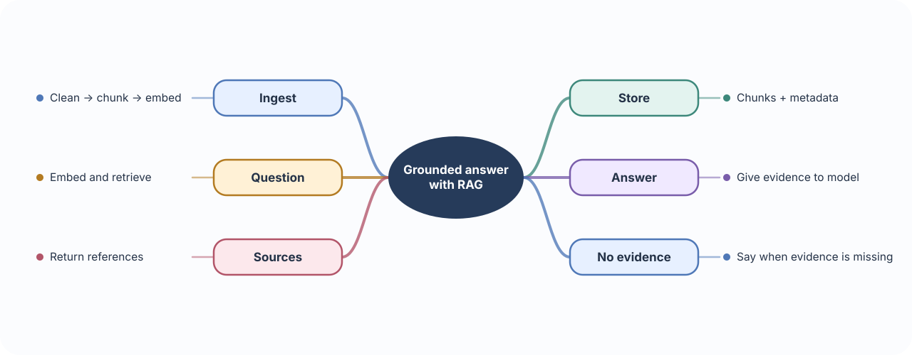
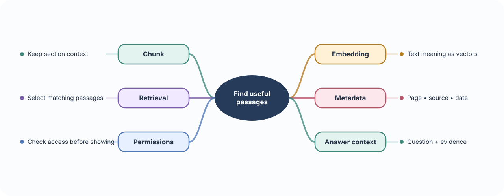
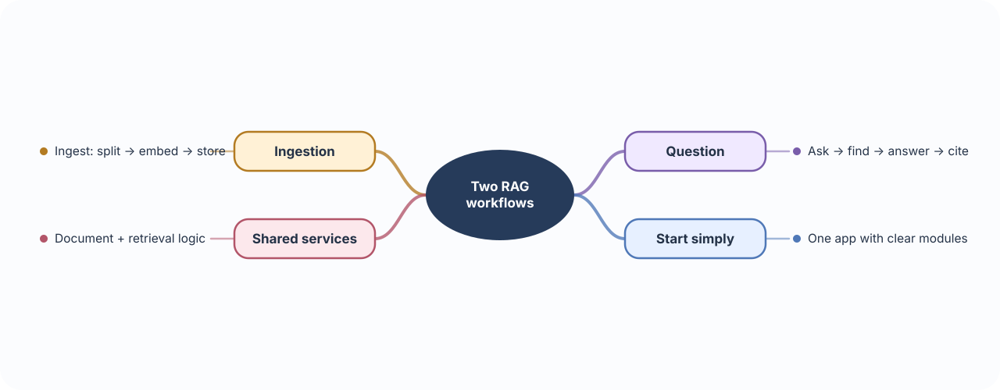
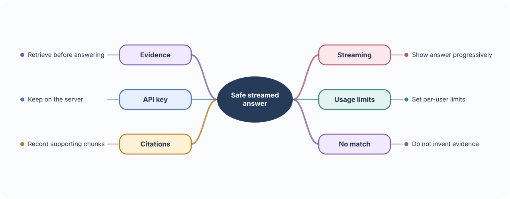

# 🧠 Build 08 · Medical Knowledge RAG Backend

> **Your build:** Let students or clinicians ask questions over lecture notes, guidelines, and approved internal documents. The answer should be grounded in retrieved material and show its sources.

**The journey:** Documents → chunks → embeddings → retrieval → answer

---

## 🧩 01 · RAG: retrieve before answering

**🧠 Concept** — Retrieval-Augmented Generation (RAG) searches a trusted collection for relevant text, then gives that text to a language model as context for an answer.

**🩺 In Medical Knowledge** — A question about a guideline should retrieve the matching passages from the uploaded guideline, not rely only on the model’s memory.

**🛠 Build it** — Build two paths:
- **Ingestion:** clean document → split into chunks → create embeddings → store chunks and metadata.
- **Question:** embed query → retrieve relevant chunks → give those chunks to the model → return answer with source references.

---

## ✂️ 02 · Chunking, embeddings & retrieval

**🧠 Concept** — A chunk is a manageable piece of a document. An embedding represents text as a vector so semantically similar text can be searched even when it does not use exactly the same words. Retrieval selects the most relevant chunks for a question.

**🩺 In Medical Knowledge** — A long lecture can be split into sections; a student question retrieves only the sections about that topic.

**🛠 Build it**

- Keep useful context with each chunk: document ID, title, page, date, and source type.
- Split around headings or meaningful sections; very small chunks lose context, very large chunks dilute search.
- Retrieve a small set of relevant chunks and inspect whether they actually support the answer.
- Filter by document permissions before showing any passage.

---

## 🧱 03 · Pipeline & service layer

**🧠 Concept** — A pipeline is a series of data transformations. A service layer organizes application operations so routes do not contain all the workflow logic. A modular monolith keeps modules organized in one application before splitting services.

**🩺 In Medical Knowledge** — Uploading a document and answering a question are different workflows, but both use the same document, chunk, and retrieval services.

**🛠 Build it** — Keep modules for ingestion, embedding, vector search, and answer generation. Start as one application with clear boundaries; separate services only when deployment or workload needs require it.

---

## 🌊 04 · Streaming, API keys & quality

**🧠 Concept** — Streaming delivers answer text as it is generated. An API key proves an application may call a model service; rate limits cap usage.

**🩺 In Medical Knowledge** — Students can see an answer build progressively. Usage limits help prevent accidental or abusive traffic.

**🛠 Build it** — Stream the response when it improves the experience. Keep model API keys on the server, add per-user limits, and record which document chunks supported each answer. If retrieval finds no relevant evidence, say so rather than inventing a citation.

### 📚 Further reading

- [FastAPI streaming responses](https://fastapi.tiangolo.com/advanced/custom-response/)
- [Redis vector sets overview](https://redis.io/docs/latest/develop/data-types/)
