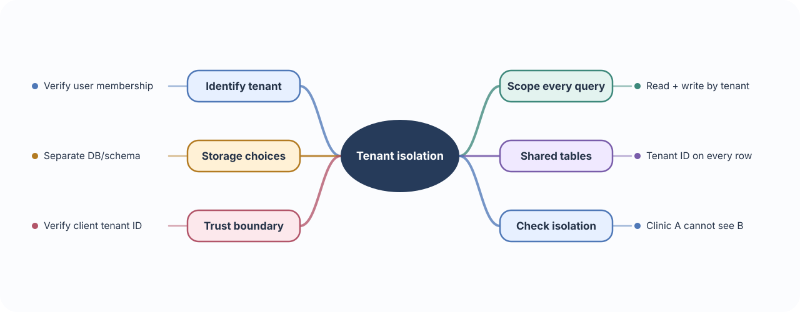
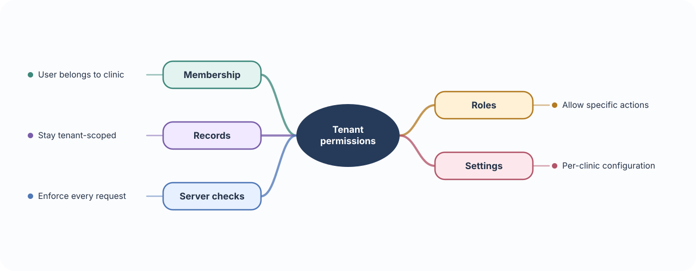
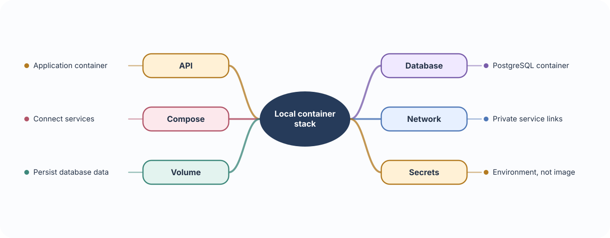
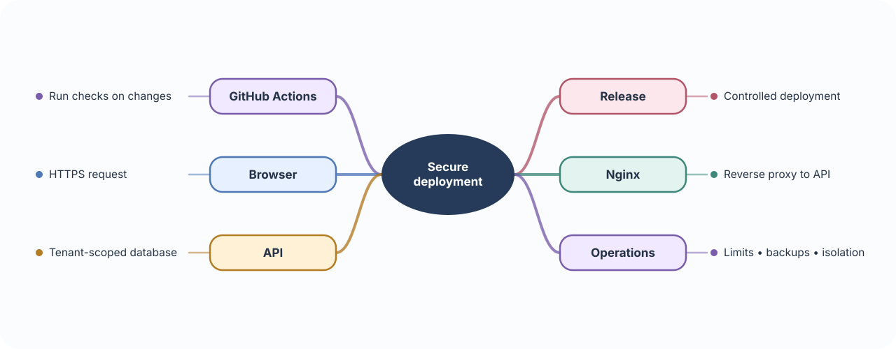

# 🏢 Build 09 · Multi-Tenant Healthcare SaaS

> **Your build:** One hosted product serves Clinic A, Clinic B, and a medical college while keeping each organization’s records and settings separate.

**The journey:** Identify organization → enforce isolation → serve its data and configuration

---

## 🏘️ 01 · Multi-tenancy & data isolation

**🧠 Concept**

- **Tenant:** An organization using the same hosted product as other organizations.
- **Multi-tenancy:** One application serves several tenants, each with its own users, data, and settings.
- **Isolation:** Every read and write is scoped so one tenant cannot access another tenant’s records.
- **Storage choices:** A shared database can tag every row with a tenant ID; separate schemas or databases create stronger boundaries but add operating cost.

**⚠️ Important to remember**

- Never trust a tenant ID just because it came from the browser. Derive the active tenant from verified membership and apply the tenant filter on every server-side query and write.
- A forgotten filter in one endpoint can leak data. Treat tenant scope as a security rule that needs tests, reviews, and consistent database/query patterns.

**🩺 In Healthcare SaaS**

- Each clinic has its own patients, users, permissions, and configuration.
- A user may belong to more than one organization, so the API must verify which organization they are acting for on each request.

**🛠 Build it**

- Choose a storage design: separate schema/database per tenant, or shared tables with a tenant ID on every row.
- Apply tenant scope on the server to every query and write.
- Check the user’s organization membership and role for the active tenant.
- Test that Clinic A cannot fetch or change Clinic B’s records.

---

## 🔐 02 · Tenant-specific permissions & configuration

**🧠 Concept**

- **Authorization:** Decides what an authenticated user may do and which tenant’s data they may use.
- **Membership:** Connects a user to a tenant, often with a role inside that tenant.
- **Tenant configuration:** Holds organization-specific settings such as branding or reminder defaults.
- Permissions decide access; configuration changes behavior or appearance. A setting must never bypass an access check.

**⚠️ Important to remember**

- The same user can be an admin in Clinic A and a staff member in Clinic B. Check the role in the active tenant, not only the user’s global account role.
- Do not let tenant settings turn off privacy checks or broaden access. Treat configuration as data, not as an authorization policy.

**🩺 In Healthcare SaaS**

- A clinic admin may manage that clinic’s staff; a staff member may only use permitted patient workflows.
- Clinics may choose different branding or reminder defaults without changing the access rules.

**🛠 Build it**

- Store organization membership, role, and tenant settings as explicit data.
- Resolve the active tenant, verify membership, then enforce the user’s role and resource permissions.
- Add tenant-specific settings deliberately; keep them separate from authorization rules.

---

## 📦 03 · Docker & Docker Compose

**🧠 Concept**

- **Image:** A packaged blueprint for an application and its runtime dependencies.
- **Container:** A running instance of an image. It has an isolated process environment, but is not a full virtual machine.
- **Docker Compose:** A configuration format and command-line tool for running related services, such as the API, database, and Redis, together.
- **Volume:** Storage mounted outside a container so selected data, such as a database directory, can survive container replacement.

**⚠️ Important to remember**

- A container’s writable filesystem is temporary. If database files must survive container recreation, store them in a persistent volume or external database.
- Do not bake passwords or signing keys into an image. Images may be shared and retained long after a container is deleted.

**🩺 In Healthcare SaaS**

- The API, database, and supporting services need a repeatable setup for local learning and deployment.
- Compose gives those services names and a private network so the API can reach the database without exposing it publicly.

**🛠 Build it**

- Build the API image and describe the API, database, network, and persistent volume in a Compose file.
- Keep secrets in environment configuration, not in the image.
- Add health checks so the API can tell when supporting services are ready.

---

## 🚀 04 · Linux, Nginx & CI/CD

**🧠 Concept**

- **VPS:** A rented virtual Linux server where an application can run.
- **Reverse proxy:** Nginx receives public requests and forwards them to the API process. It can handle HTTPS and other edge settings.
- **HTTPS/TLS:** Encrypts data between the client and public service, helping protect credentials and patient data in transit.
- **CI/CD:** Continuous integration runs automated checks on changes; continuous delivery/deployment prepares or releases those changes through a controlled process.

**⚠️ Important to remember**

- A reverse proxy is part of the security boundary. Trust forwarded client IP or scheme headers only from a known proxy, not directly from arbitrary clients.
- A deployment plan needs backups and a tested restore path, not only an automated release command.

**🩺 In Healthcare SaaS**

- Clinics need a stable, encrypted endpoint and a consistent release process.
- The public proxy forwards requests to the private API; the API reaches the database through a restricted network.

**🛠 Build it**

- Run the app and database on a managed or self-managed host.
- Put a reverse proxy in front of the API; configure HTTPS and request limits.
- Use GitHub Actions to run checks on changes and deploy only from a controlled workflow.
- Back up data, test restoration, and verify tenant isolation before a release.

### 📚 Official references

- [Docker Compose overview](https://docs.docker.com/compose/)
- [GitHub Actions continuous integration](https://docs.github.com/en/actions/get-started/continuous-integration)
- [Nginx documentation](https://nginx.org/en/docs/)
