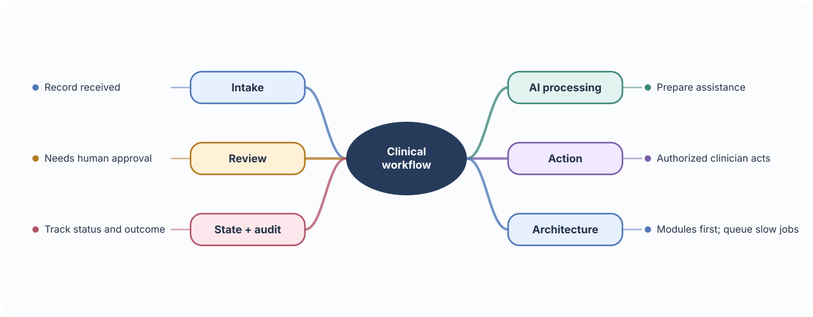
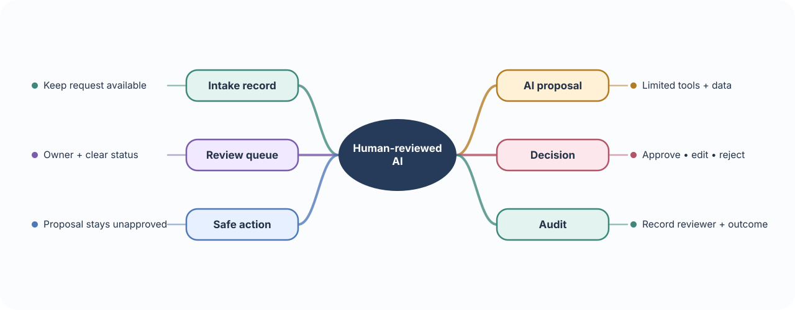
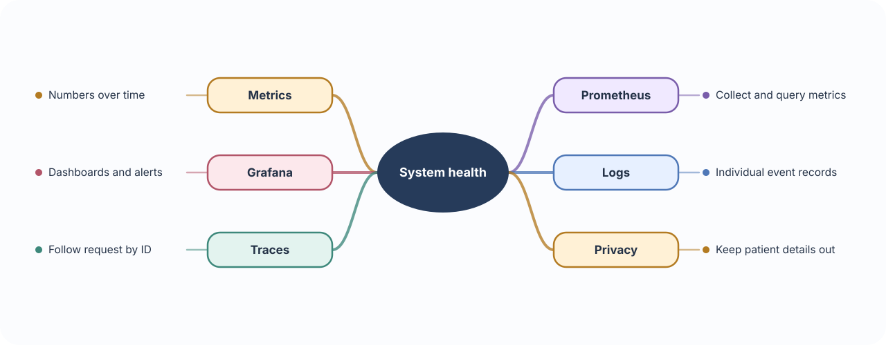
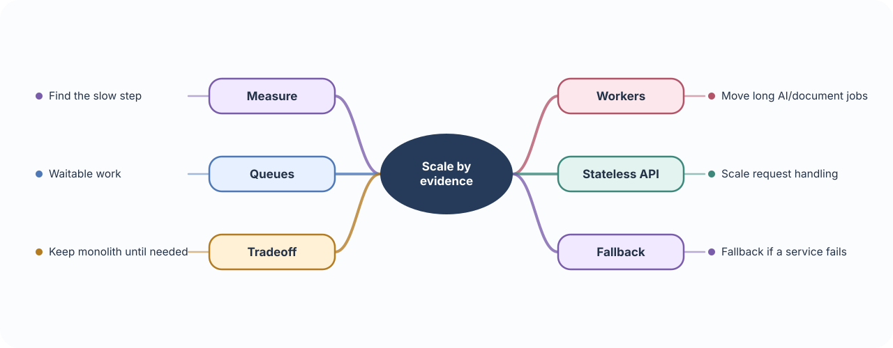

# 🏥 Build 10 · AI Clinical Operations Platform

> **Your build:** Turn a slow manual workflow into a trackable process: patient intake → AI assistance → human review → documented action.

**The rule:** AI prepares or organizes work; an authorized human reviews clinical decisions before action.

---

## 🧭 01 · Workflow architecture

**🧠 Concept** — Architecture is how components and responsibilities fit together. A monolith keeps features in one deployable application; event-driven systems communicate through recorded events and asynchronous handlers.

**🩺 In Clinical Operations** — Intake, AI processing, review, and action need clear ownership and a record of each state change.

**🛠 Build it** — Model the workflow as explicit states, such as received, processing, needs review, approved, and completed. Start with clear modules in one app; add events or queues where slow work or independent scaling requires them.

---

## 🤖 02 · Agents, queues & human review

**🧠 Concept** — An agent is a model-driven process that can choose from permitted steps or tools toward a goal. A queue holds work for later processing. Human review is a checkpoint where a person verifies the proposed result.

**🩺 In Clinical Operations** — An AI assistant may summarize intake or prepare a triage suggestion. A clinician reviews it and records whether it is accepted, changed, or rejected.

**🛠 Build it**

- Limit the agent to defined tools and data.
- Keep proposed output separate from approved action.
- Put review-required cases into a queue with clear status and ownership.
- Record who reviewed the output and what action followed.
- Handle timeouts and failures without losing the intake record.

---

## 📊 03 · Observability: metrics, logs, traces

**🧠 Concept** — Observability helps explain what a running system is doing.
- **Metrics** are numbers tracked over time.
- **Logs** are individual event records.
- **Traces** follow one request across components.

**🩺 In Clinical Operations** — Teams need to notice rising processing delays, failed jobs, or stalled reviews without exposing patient details.

**🛠 Build it** — Track request duration, queue depth, processing failures, and review wait time. Prometheus stores and queries metrics; Grafana displays dashboards and alerts. Use request IDs to connect logs and traces; keep protected health information out of metric labels and routine logs.

---

## 📈 04 · Production scaling & tradeoffs

**🧠 Concept** — Scaling adds capacity when demand grows. Event-driven design can isolate work, but adds operational complexity. A monolith is often simpler until a clear scaling or ownership need appears.

**🩺 In Clinical Operations** — Intake may be fast, while AI processing or human review takes longer and has different capacity limits.

**🛠 Build it** — Measure slow steps first. Move long AI or document jobs to workers; keep APIs stateless where possible; use queues for work that can wait. Define alerts and a safe fallback when AI or downstream services fail.

### 📚 Official references

- [Prometheus overview](https://prometheus.io/docs/introduction/overview/)
- [Grafana getting started](https://grafana.com/docs/grafana/latest/fundamentals/getting-started/)
- [GitHub Actions workflows](https://docs.github.com/en/actions/concepts/workflows-and-actions/workflows)
