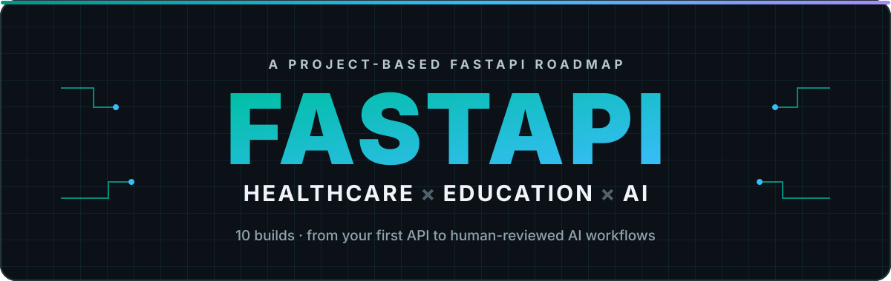

  
  
  

  

<strong>Build practical systems for care and learning, one layer at a time.</strong>

  
  
  

---

Ten progressive FastAPI projects turn each new skill into a useful healthcare or education system—and a focused portfolio.

> **Learn → Build → Break → Refactor → Test → Deploy → Next**

## The roadmap

| # | Project | Core skills |
|---|---|---|
| 1 | Patient Task Management API | FastAPI, Pydantic, CRUD |
| 2 | Clinical Notes Backend | PostgreSQL, SQLAlchemy, migrations |
| 3 | Education Auth Platform | JWT, OAuth2, role-based access |
| 4 | Medical Content Upload API | Uploads, streaming, async work |
| 5 | Healthcare Appointment Backend | Services, transactions, testing |
| 6 | Medical Tutor Chat Backend | Streaming, SSE, WebSockets |
| 7 | Medical Document Processing Pipeline | Celery, Redis, background workers |
| 8 | Medical Knowledge RAG Backend | Chunking, embeddings, retrieval |
| 9 | Multi-Tenant Healthcare SaaS | Tenant isolation, Docker, CI/CD |
| 10 | AI Clinical Operations Platform | AI workflows, human review, observability |

## Getting started

Start with **Build 1** and follow the sequence; each project builds on the last. Use [`projects.md`](projects.md) for project briefs and [`syllabus.md`](syllabus.md) for learning topics and progress checklists.

**North star:** thoughtful, reliable AI systems that support healthcare and education.
