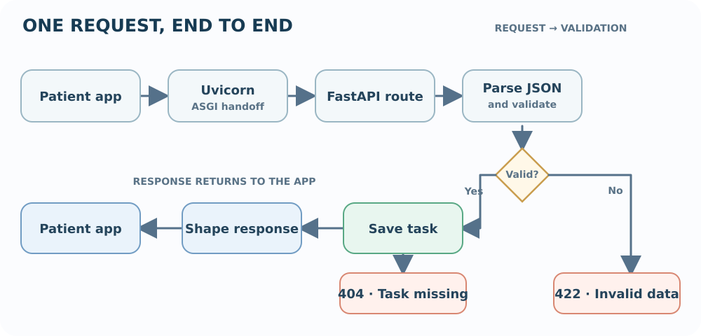

# Build 01 · Patient Task Management API

> **Your build:** A backend where patients can add daily tasks and care-plan reminders, view them, update them, and track completion. The API stores reminder details; it does not choose treatment.

**The journey:** App → Request → FastAPI → Task action → Response

---

## 01 · Start the API
### FastAPI · ASGI · Uvicorn

**Concept**

- **API:** The agreed way one program asks another program to do something and receives a result. The patient app calls the API instead of reaching into the server’s Python code.
- **FastAPI:** The Python framework where we define the API’s routes, input rules, and operations, such as “create a task.”
- **Uvicorn:** The web server that listens for requests from apps and passes them to the FastAPI application.
- **ASGI (Asynchronous Server Gateway Interface):** The standard handoff between Uvicorn and FastAPI. It lets the server and Python application pass requests and responses to each other.
- **Together:** Uvicorn receives; ASGI hands off; FastAPI chooses and runs the operation; the response travels back to the app.

**Important to remember**

- Creating `app = FastAPI()` creates the application object; it does not start a web server. Uvicorn starts listening when you run the development command.
- `async def` does not automatically make code faster. Async helps when the code awaits async-friendly I/O; a blocking call inside an async route can still hold up other requests.

**In Patient Tasks**

- When a patient taps “complete,” the app sends a request to Uvicorn.
- FastAPI finds the operation for that request, updates the task, and sends the result back to the app.

**Build it**

- Add FastAPI and its standard tools. The standard extra includes Uvicorn:

  ~~~sh
  uv add "fastapi[standard]"
  ~~~

- Create the FastAPI app in `main.py`:

  ~~~python
  from fastapi import FastAPI

  app = FastAPI()
  ~~~

- Start the development server. It reloads when code changes.
- FastAPI generates `/docs` from the API’s routes and models; open it in a browser to explore and try the API.

  ~~~sh
  uv run fastapi dev main.py
  ~~~

---

## 02 · HTTP messages  
### Requests · responses · JSON

**Concept**

- **HTTP (Hypertext Transfer Protocol):** The request-and-response conversation apps use with web servers. The app sends a request; the API sends one response.
- **Method:** Says what action the app wants, such as read (`GET`) or create (`POST`).
- **Path:** Says which resource is involved, such as `/tasks/81` for task 81.
- **Query:** Adds optional list choices, such as `?due=today`. It usually filters a result rather than naming a different operation.
- **Headers:** Carry request details, such as the data format. `Content-Type: application/json` tells the API the body is JSON.
- **Body:** Carries the data to create or change. A read request often has no body.
- **Response:** Includes a status code for the outcome and may include a body with returned data.
- **JSON (JavaScript Object Notation):** A common format for structured data. Objects use named fields; values can be text, numbers, `true`/`false`, or `null` (no value).

**Important to remember**

- **HTTP is stateless:** Each request stands on its own. The server does not automatically remember which task the previous request was about, so include the needed ID and data each time.
- **Omitted and `null` are different:** Omitted means “no value was sent”; `null` explicitly means “there is no value.” This distinction matters when updating an optional due time.

**In Patient Tasks**

- To add a task, the app sends the title and due time in the request body.
- The API replies with the saved task, including its server-assigned ID, or an error that explains why the request was rejected.

**Build it**

- Put create/update fields in a JSON body. For example:

~~~json
{
  "title": "Walk for 20 minutes",
  "due_at": null
}
~~~

- `POST` — create a task.
- `/patients/42/tasks` — create it in patient 42’s task collection.
- The JSON body — supplies fields such as `title` and `due_at`.
- The response — reports a status and, on success, the saved task.

---

## 03 · Routes & HTTP methods  
### Send each action to the right operation

**Concept**

- **Route:** A rule that connects a request to a Python operation.
- **Route match:** FastAPI checks both the HTTP method and path. `GET /tasks/81` and `PATCH /tasks/81` use the same path but run different operations.
- **Path parameter:** Identifies the resource, such as patient `42` or task `81`.
- **Query parameter:** Adds an option to a request, often to filter a list, such as `?due=today`.
- **HTTP method:** Signals the intended action. The method names are conventions that make APIs predictable for clients.

**Important to remember**

- **Keep `GET` read-only.** Browsers, caches, or clients may repeat a `GET`; it should not mark a task complete or otherwise change data.
- **Specific routes can overlap with variable routes.** If you add `/tasks/today` as well as `/tasks/{task_id}`, declare the fixed `/tasks/today` route first so `today` is not treated as an ID.
- **An ID is not permission.** Knowing `/tasks/81` must not be enough to read or change it; a later authenticated version must also check that the signed-in user may access that task.

**In Patient Tasks**

- Use a patient ID in the path to find that patient’s tasks and a task ID to target one task.
- Use a query value to filter the list without changing which operation runs.

**Build it**

- `GET /patients/42/tasks` — read patient 42’s task list. Add `?due=today` to filter it.
- `GET /tasks/81` — read one task.
- `POST /patients/42/tasks` — create a task for patient 42.
- `PUT /tasks/81` — replace the task by sending its full new representation.
- `PATCH /tasks/81` — change only selected fields, such as its completion status.
- `DELETE /tasks/81` — remove the task.
- For this beginner project, remember: `PUT` sends a replacement; `PATCH` sends only changes.

---

## 04 · Pydantic BaseModel  
### Describe the data shape

**Concept**

- **Model/schema:** A description of the data an API accepts or returns: field names, types, and required values. Think of it as a form definition.
- **Pydantic `BaseModel`:** The Python tool used to define that description.
- **Parsing:** FastAPI reads the JSON body and Pydantic turns it into a Python object whose fields can be accessed by name.
- **Type checking:** Pydantic checks values against the declared types. If required fields are missing or values cannot be accepted, FastAPI returns a validation error before the operation changes a task.
- **Important boundary:** These models define the API’s data shape. They do not save data in a database by themselves.

**Important to remember**

- In Pydantic v2, `due_at: datetime | None` allows `null`, but the field is still required unless it has a default such as `= None`.
- For partial updates, save only fields the client actually sent. In Pydantic, `model_dump(exclude_unset=True)` helps keep omitted fields from accidentally overwriting saved values.

**In Patient Tasks**

- **Create model:** Requires a title; the due time can be absent. The server supplies the ID and initial `completed = false` value.
- **Update model:** Accepts only the fields the patient wants to change.
- **Response model:** Includes the saved task’s ID, title, due time, and completion state.

**Build it**

- Use separate models for task creation, partial updates, and responses; each has a different job.
- A field with a default can be omitted from the request.
- A field that allows `null` can explicitly have no value; for example, a patient could clear a task’s due time.
- For a partial update, an omitted field means “keep the current value”; a supplied value means “change it.”
- This difference matters: if the patient omits `due_at`, keep its old value; if they send `"due_at": null`, clear it.

---

## 05 · Validation  
### Catch invalid data before saving

**Concept**

- **Purpose:** Check a request before using its data, so invalid input does not corrupt or confuse task data.
- **Shape/type checks:** Is `title` text? Is `completed` a true/false value? Are required fields present? FastAPI and Pydantic handle many of these checks.
- **Field rules:** Does the title contain something besides spaces? Is the due time in a format we understand? We add rules like these to the application.
- **Business rules:** Is this action allowed for this task? For example, a completed task may not be editable in a future version of the project.
- **Validation vs permission:** Valid data does not prove the user is allowed to change a task. The API must check permission separately when the project adds users and authentication.

**Important to remember**

- FastAPI checks the request shape before it runs the route function. If the body is invalid, the code that changes the task does not run.
- Validation answers “is this data acceptable?” Authorization answers “is this user allowed?” A request can pass validation and still be forbidden.

**In Patient Tasks**

- Reject a blank title, a date/time the API cannot understand, or a completion value that is not true or false.
- A request can have the right shape and still break a project rule. Check both before changing a task.
- Reminder details must come from an authorized care plan; valid input alone does not grant permission to create a reminder.

**Build it**

- Let FastAPI/Pydantic report missing or wrongly typed fields.
- Add task-specific checks before changing the task.
- Return status `422` for invalid request data. It tells the app to correct the request and try again.

---

## 06 · CRUD  
### Manage task records

**Concept**

- **Create:** Add a new record.
- **Read:** Fetch one record or a list of records.
- **Update:** Change some or all fields on an existing record.
- **Delete:** Remove a record or make it no longer available.
- CRUD describes what happens to the data; HTTP methods and routes are how a client asks the API to do it.

**Important to remember**

- A Python list is temporary storage, not a database. Restarting the app clears it.
- Each Uvicorn worker is a separate process with its own memory. With multiple workers, one may not see a task another worker added; use a shared database for real persistence.

**In Patient Tasks**

- Create a task, read one task or the patient’s list, update its title or completion state, and delete it.
- Each action must target the intended task and tell the app what happened.

**Build it**

- Connect each CRUD action to a route.
- Use an in-memory list for this first exercise. It is simple, but it disappears when the server restarts and is not shared between separate server processes.
- Build 2 adds a database so tasks remain saved after the API stops.

---

## 07 · Response models & status codes  
### Return a predictable result

**Concept**

- **Response model:** Describes the fields and types the API sends back. It makes the output predictable and can keep internal fields out of the response.
- **Status code:** A standard number that summarizes the result. The app can react to it without guessing from a message.
- **2xx:** The request succeeded.
- **4xx:** The request could not be completed as sent, for example because the task was missing or the data was invalid.

**Important to remember**

- A response model only protects fields that are left out of that model. If a field is added to the response schema, the API may expose it to clients.
- `204` means there is no response body. If the app needs the deleted task returned, choose a response that includes a body instead.

**In Patient Tasks**

- Return the task ID, title, due time, and completion status in the same shape after creating, reading, or updating a task.
- The app can display those known fields without depending on internal server details.

**Build it**

- Use a task response model for create/read/update results.
- `200` — read or update succeeded; the response usually includes the task.
- `201` — the task was created; the response can include the new task.
- `204` — the task was deleted; there is no response body.
- `404` — the requested task was not found.
- `422` — the request data failed validation.

---

## 08 · HTTPException  
### Report expected errors

**Concept**

- **Expected error:** A normal situation the API should handle, such as asking for a task that does not exist.
- **Raise `HTTPException`:** Stop the current operation immediately and return the chosen HTTP status and `detail` message to the app.
- **Safe detail:** Explain the problem in a way the user can act on, without exposing internal code or sensitive data.
- **Not every failure is expected:** A missing task is a 404; invalid input is usually a 422; an unexpected bug should become a generic 500 response while its technical details stay in server logs.

**Important to remember**

- Use `raise HTTPException(...)`, not `return HTTPException(...)`. Raising stops the route and lets FastAPI build the error response.
- The `detail` text is sent to the client. Keep it useful and safe; do not put stack traces, database errors, or private patient information there.

**In Patient Tasks**

- If task 81 does not exist, return `404` so the app knows there is nothing to update.
- Returning success would mislead the app and the patient into thinking the task changed.

**Build it**

- Look up the task before updating or deleting it.
- If it is missing, raise `HTTPException` with status `404` and a short, safe message. The route stops instead of trying to change a nonexistent task.
- Let FastAPI return `422` for invalid request data. Keep unexpected technical details in server logs, not in the response.

---

## One request, end to end

**Example:** The patient marks task 81 complete by sending:

~~~http
PATCH /tasks/81
Content-Type: application/json

{"completed": true}
~~~

**Follow the request:**

- **Receive:** Uvicorn receives the HTTP request and hands it to FastAPI through ASGI.
- **Choose the operation:** FastAPI matches `PATCH /tasks/{task_id}` and reads `81` as the task ID.
- **Check the body:** Pydantic turns the JSON into update data; validation checks `completed` is true or false.
- **Apply the change:** The task operation finds task 81 and changes its completion state.
- **Reply:** The response model shapes the returned task; status `200` tells the app the update succeeded.
- **If the task is missing:** The operation stops and returns `404` instead.

{.flow-figure}

### Official references

- **FastAPI:** [first steps](https://fastapi.tiangolo.com/tutorial/first-steps/) · [request bodies](https://fastapi.tiangolo.com/tutorial/body/) · [path and query parameters](https://fastapi.tiangolo.com/tutorial/query-params/) · [response models](https://fastapi.tiangolo.com/tutorial/response-model/) · [errors](https://fastapi.tiangolo.com/tutorial/handling-errors/)
- **Runtime:** [ASGI specification](https://asgi.readthedocs.io/en/latest/specs/main.html) · [Uvicorn](https://www.uvicorn.org/)

# Build 02 · Clinical Notes Backend

> **Your build:** A doctor creates and edits notes for a patient, searches them, and reviews visit history. Notes are sensitive records, so each note must stay connected to the correct patient and be shown only to authorized users.

**The journey:** Patient → Visit → Note → Search/history

---

## 01 · PostgreSQL & SQL  
### Give notes a reliable home

**Concept**

- **Database:** A place for an application’s data to persist after the API restarts.
- **Relational database:** Stores data in tables made of rows and columns. A row is one record; a column is one kind of value, such as a patient name.
- **Primary key:** A unique ID for one row. The ID lets the application refer to that patient or note without confusing two people with the same name.
- **PostgreSQL:** The database server that stores these tables and applies rules to them.
- **SQL:** The language used to create tables and query or change rows.

**Important to remember**

- A database is the durable source of truth; an in-memory Python list disappears when the process stops.
- Prefer stable IDs for relationships. Names and dates can repeat or change, so they are poor substitutes for record IDs.

**In Clinical Notes**

- Keep patients in a `patients` table and visit notes in a `notes` table.
- A note belongs to one patient, while one patient can have many notes. The note stores the patient’s ID to connect the records.

**Build it**

- Create patient and note tables with clear columns and primary keys.
- Put the patient ID on each note, then query notes by patient, visit date, or search text.
- Add database constraints so a note cannot point to a patient that does not exist.

---

## 02 · SQLAlchemy, SQLModel & sessions  
### Work with database rows in Python

**Concept**

- **ORM:** An Object-Relational Mapper connects database rows and tables to Python objects and classes. It saves us from writing raw SQL for every common operation, but SQL still runs underneath.
- **SQLAlchemy:** The main Python toolkit used here to define mappings, build queries, and manage sessions.
- **Session:** A short-lived workspace for database work. It loads rows, tracks changes, and commits or rolls them back.
- **SQLModel:** A higher-level option built on SQLAlchemy and Pydantic. It uses Python type annotations for validation and database mapping.

**Important to remember**

- Creating or changing a Python object does not necessarily save it. The session must commit the database transaction.
- A session is not a global shared object. Give each request its own session and close it when the request ends.

**In Clinical Notes**

- A `Patient` object and a `Note` object represent rows in their corresponding tables.
- The API creates notes through a session and uses queries to find a patient’s history.

**Build it**

- Learn the SQLAlchemy model, query, and session flow first.
- Use a session to query or change rows; commit successful changes and close the session after the request.
- Try SQLModel as a concise way to define models. Keep request/response models distinct when the API needs different fields.

---

## 03 · Relationships, CRUD & transactions  
### Keep patient history consistent

**Concept**

- **Foreign key:** A database column that points to a row in another table. It lets the database check that a related record exists.
- **ORM relationship:** A Python-friendly way to navigate linked records, such as `patient.notes`. It uses the foreign key underneath.
- **CRUD:** Create, read, update, and delete records through queries and database operations.
- **Transaction:** A group of database changes treated as one unit. It commits all changes together, or rolls them all back if a step fails.

**Important to remember**

- Checking for a patient in application code is not enough to prevent every invalid link; keep the foreign key constraint in the database too.
- Use one transaction for changes that must succeed together. Keep it short and do not wait for a slow external service while holding it open.

**In Clinical Notes**

- Every note must belong to a real patient.
- If creating a visit requires multiple related rows, save them in one transaction so an error does not leave only half the visit behind.

**Build it**

- Link each note to a patient with a foreign key.
- Implement create, read, update, and delete using database queries.
- Search notes through the patient relationship.
- Use a transaction when one user action changes multiple related rows.

---

## 04 · Dependency injection, Alembic & project structure  
### Keep the backend maintainable

**Concept**

- **Dependency injection:** A way to provide a route with something it needs, such as a database session, instead of making the route create and manage it itself.
- **FastAPI `Depends`:** Declares that requirement. A dependency can open a session for the request and reliably close it afterward.
- **Project structure:** Keeps routes, schemas, database setup, and business logic in separate modules so each part has a clear job.
- **Alembic migration:** A versioned set of database changes, such as adding a column. Migrations let an existing database move from one schema version to the next.

**Important to remember**

- Editing a Python model does not change an existing database table. Create and apply a migration for schema changes.
- Do not log clinical note content. Logs help investigate failures, but they can also become an unintended copy of sensitive records.

**In Clinical Notes**

- Each request needs a database session that is closed even if the route fails.
- As patient and note tables evolve, Alembic gives existing databases a controlled upgrade path.

**Build it**

- Use FastAPI `Depends()` to provide and close a session per request.
- Put routes, database models, request/response schemas, and database setup in separate modules.
- Create an Alembic migration for each schema change; practice applying and reverting one.
- Keep clinical content out of routine logs.

### Official references

- [PostgreSQL tutorial](https://www.postgresql.org/docs/current/tutorial.html)
- [SQLAlchemy ORM quick start](https://docs.sqlalchemy.org/en/20/orm/quickstart.html) · [Sessions](https://docs.sqlalchemy.org/en/20/orm/session_basics.html)
- [SQLModel tutorial](https://sqlmodel.tiangolo.com/tutorial/) · [Alembic tutorial](https://alembic.sqlalchemy.org/en/latest/tutorial.html)

# Build 03 · Medical Education Auth Platform

> **Your build:** Students, instructors, and admins can register and sign in. The API checks who they are and what each role is allowed to do.

**The journey:** Register → verify password → sign in → receive token → access allowed routes

---

## 01 · Authentication vs authorization

**Concept**

- **Authentication:** Proves who the user is, usually by checking a password or another sign-in factor.
- **Authorization:** Decides what an authenticated user may do, based on a role, permission, ownership, or other policy.
- **Role:** A named group of permissions, such as `student`, `instructor`, or `admin`.
- A user may be signed in but still lack permission to use a particular operation.

**Important to remember**

- Hiding a button in the browser is not security. A user can call the API directly, so enforce permissions on the server for every protected operation.
- A role alone may not be enough: also check which course or account the user may access. Use `401` for not signed in and `403` for signed in but not allowed.

**In this platform**

- A student can view learning material; an instructor can manage lessons; an admin can manage users and roles.
- The API checks the user's identity and permission before returning or changing protected data.

**Build it**

- Define student, instructor, and admin roles and list the actions each role may perform.
- For each protected operation, check the signed-in user’s role and any needed resource ownership on the server.
- Deny access by default when no rule explicitly allows the action.

---

## 02 · OAuth2 & JWT  
### Sign in and carry access

**Concept**

- **OAuth 2.0:** A standard framework for granting limited access to an API. A bearer token is sent with a request to prove the caller has a valid access token.
- **JWT:** A compact token containing claims, such as a user ID (`sub`) and expiry (`exp`). It is commonly used to carry identity-related information between requests.
- A signed JWT has a header, payload, and signature. The API checks the signature and expiry before trusting its claims.
- A signature detects changes; it does not hide the payload. Anyone holding a normal signed JWT can usually read its contents.

**Important to remember**

- Do not put passwords, signing keys, or sensitive student data in a JWT. Signing is not encryption.
- JWTs are difficult to revoke before they expire unless the system tracks revocation. Keep access tokens short-lived and protect, rotate, and revoke refresh tokens.

**In this platform**

- After sign-in, the client sends its access token with later requests.
- FastAPI verifies the token and uses its trusted user ID to make an authorization decision.

**Build it**

- Registration stores a password hash; login verifies the submitted password before issuing a token.
- Use a bearer-token flow for protected requests. OpenID Connect adds standard identity information on top of OAuth2 when needed.
- Keep access tokens short-lived. Use a refresh token to obtain a new access token; protect, rotate, and revoke refresh tokens.
- Put only necessary claims in a JWT and verify its signature and expiry on every request.

---

## 03 · Password hashing  
### Never save a readable password

**Concept**

- **Hashing:** Turns a password into a one-way value that can be checked later; it is designed not to be reversed.
- **Encryption:** Protects data in a reversible form when the right key is available. Passwords should be hashed, not encrypted for later recovery.
- **Salt:** A unique random value mixed into a password before hashing. It makes equal passwords produce different stored hashes and defeats precomputed lookup tables.
- A password-hashing algorithm is deliberately slow, making large-scale guessing more expensive.

**Important to remember**

- Do not use a fast general-purpose hash such as SHA-256 for passwords. Use a maintained password-hashing library with its recommended algorithm and settings.
- Let the library generate and store the salt as part of the encoded hash. Never store or log the original password.

**In this platform**

- Registration stores the password hash, not the password.
- Login checks the submitted password against the stored hash; only a match allows sign-in and token issuance.

**Build it**

- Use a maintained password-hashing library and its recommended settings.
- The syllabus names bcrypt; before a new production system, check current security guidance and the library’s recommendations.
- Never store or log plain passwords.

---

## 04 · RBAC, middleware & secrets  
### Apply security consistently

**Concept**

- **RBAC:** Role-Based Access Control assigns permissions to roles, then assigns users to those roles.
- **Dependency or middleware:** Shared request-handling code. A FastAPI dependency is useful for checks on chosen routes; middleware runs around many or all requests and suits cross-cutting tasks such as request IDs.
- **Secret:** A credential such as a signing key or database password. Anyone who gets it may be able to impersonate the service or access its data.

**Important to remember**

- Middleware is not automatically the right place for every permission check. Route-specific authorization is often clearer as a dependency that names the requirement.
- A secret committed to Git should be considered exposed. Remove it from use and rotate it; deleting the visible line does not erase it from Git history.

**In this platform**

- A course-management route can require instructor or admin permission, while a learning-material route can allow students.
- The check must happen in the API even if the interface already hides actions from that role.

**Build it**

- Write a role/action table before adding protected routes.
- Put reusable sign-in and role checks into dependencies; use middleware for genuinely shared request behavior.
- Load signing keys and database credentials from environment configuration.
- Keep local secrets out of Git; rotate any exposed keys.

### Official references

- [FastAPI OAuth2, JWT, and password hashing](https://fastapi.tiangolo.com/tutorial/security/oauth2-jwt/)
- [OAuth 2.0 specification](https://datatracker.ietf.org/doc/html/rfc6749) · [JWT specification](https://datatracker.ietf.org/doc/html/rfc7519)
- [OWASP password storage guidance](https://cheatsheetseries.owasp.org/cheatsheets/Password_Storage_Cheat_Sheet.html)

# Build 04 · Medical Content Upload API

> **Your build:** Medical colleges can upload PDFs, slides, and medical images, save metadata, preview or download files, and start processing.

**The journey:** Upload → validate → store file + metadata → preview or process

---

## 01 · File uploads & metadata

**Concept**

- **Multipart form data:** An HTTP format that can send file bytes and ordinary fields, such as a title, in one request.
- **File bytes:** The actual contents of the PDF, slide deck, or image. Large files should be handled without loading the entire file into application memory.
- **Metadata:** Facts that describe the file, such as its display name, size, media type, uploader, and storage key. Metadata helps the app find and manage the file; it is not the file itself.
- **`UploadFile`:** FastAPI’s upload interface, which exposes file information and lets the application read the content.

**Important to remember**

- A filename and `Content-Type` arrive from the client, so neither proves a file is safe or truly has that format. Check size and inspect/validate content as appropriate.
- Store files under server-generated keys, not a path built from the submitted filename. This avoids filename collisions and path-traversal risks.

**In this API**

- A lecture PDF or medical image needs a stable record so a college can find it and request a preview later.
- Store the content in file/object storage and the metadata in the database, linked by a file ID or storage key.

**Build it**

- Receive uploads with FastAPI’s `UploadFile`.
- Enforce size limits and allowed media types; do not trust the filename or client-provided content type alone.
- Save the file in file/object storage and save its metadata separately.
- Return a stable file ID, not a server filesystem path.

---

## 02 · Streaming downloads & previews

**Concept**

- **Normal file response:** The server may need the whole file ready before sending it, which can use a lot of memory for large content.
- **Streaming:** Sends or reads the file in smaller pieces. The app can start receiving data before the entire file has been sent.
- Streaming is especially useful for large PDFs, images, or generated content; it does not decide who is allowed to access the file.

**Important to remember**

- Check that the signed-in user may access the file before starting the stream. A hard-to-guess file ID is not an authorization check.
- A stream can fail after some bytes have been sent. At that point the API cannot replace the partial response with a fresh JSON error.

**In this API**

- A user previews a lecture PDF or downloads a stored slide deck.
- The API finds the file by its ID, checks access, then streams the content with a useful content type and download name.

**Build it**

- Look up the file by ID and confirm access before sending any content.
- Use FastAPI’s `StreamingResponse` or `FileResponse` with the correct content type and download name.
- Do not expose a raw local path.

---

## 03 · Sync, async, event loop & concurrency

**Concept**

- **Synchronous code:** Waits for an operation to finish before moving to the next line.
- **Asynchronous code:** Can pause at an `await` while waiting for network, database, or file I/O, letting the event loop work on another request.
- **Concurrency:** Managing several operations that are in progress at once. It improves use of time spent waiting; it does not make CPU-heavy work run faster by itself.
- **CPU-heavy work:** OCR or image conversion keeps the processor busy rather than waiting. It usually belongs in a separate worker process.

**Important to remember**

- `async def` is only helpful when slow I/O uses async-compatible libraries. A blocking library call inside an async route can stall the event loop.
- Concurrency is not the same as parallel processing. Use workers or other process-level tools for substantial CPU work.

**In this API**

- Uploads and remote storage may involve waiting for I/O.
- Image conversion and OCR can take significant CPU time and should not hold up normal API requests.

**Build it**

- Use async endpoints with libraries that support `await`.
- Avoid blocking the event loop with slow synchronous work; move heavier processing to a worker in Build 7.

---

## 04 · Background tasks

**Concept**

- **Background task:** Work started after the API sends its response, so the user does not wait for a small follow-up action to finish.
- The original response means the request was accepted; it does not mean the background work has completed successfully.
- FastAPI `BackgroundTasks` runs lightweight work in the application process.

**Important to remember**

- In-process background tasks are not a durable job system. If the process stops, queued work may be lost; there is no built-in retry or job status.
- Use a queue and worker for long, CPU-heavy, retryable, or business-critical jobs. Return a job ID and let the client check progress.

**In this API**

- After storing a file, the API can schedule a lightweight notification or preview task.
- For document extraction that may take minutes, return a job ID and let a worker report its status.

**Build it**

- Use FastAPI `BackgroundTasks` for small, short follow-up work.
- Use a queue and worker, as in Build 7, for durable, CPU-heavy, or retryable processing.

### Official references

- [FastAPI file uploads](https://fastapi.tiangolo.com/tutorial/request-files/)
- [FastAPI streaming and file responses](https://fastapi.tiangolo.com/advanced/custom-response/)
- [FastAPI background tasks](https://fastapi.tiangolo.com/tutorial/background-tasks/)
- [FastAPI async and await](https://fastapi.tiangolo.com/async/)

# Build 05 · Healthcare Appointment Backend

> **Your build:** Patients find a doctor’s open time slot, book it, and review visit history. The system must prevent two patients from booking the same slot.

**The journey:** Find slot → request booking → confirm once → record visit

---

## 01 · Project structure & service layer

**Concept**

- **Route:** Handles the HTTP boundary: receives validated input and returns an HTTP response.
- **Service layer:** Holds application decisions and workflows, such as deciding whether a slot can be booked.
- **Models and database layer:** Describe stored records and perform database work.
- **Schemas:** Describe the input and output shape the API accepts and returns.
- **Configuration:** Holds values that change by environment, such as a database URL, outside the business rules.

**Important to remember**

- A service layer helps when a workflow has rules or several steps; a tiny endpoint may not need extra layers. Keep the route thin once logic becomes reusable or involved.
- Separation is useful only when each module has a clear job. Splitting files without clear responsibilities can make navigation harder, not easier.

**In Appointments**

- Booking involves patients, doctors, slots, and appointments.
- The route receives the request; a booking service applies availability rules; the database layer saves the appointment.

**Build it**

- Organize responsibilities into modules such as `api/`, `services/`, `models/`, `schemas/`, `db/`, and `config/`.
- Keep the route focused: validate the request, call the booking service, and return its result.

---

## 02 · Transactions & scheduling

**Concept**

- **Transaction:** Groups database changes as one unit. If all steps work, commit them; if a step fails, roll them back so the database is not left half-updated.
- **Race condition:** Two requests can arrive at almost the same time and both see a slot as open before either saves its booking.
- **Database constraint:** A rule in the database that rejects conflicting bookings even if two requests race.
- **Time zone:** A rule that converts a stored moment into local clock time. Regions change offsets, including daylight-saving changes.

**Important to remember**

- Checking availability in Python alone is not enough: two requests can pass the check at once. The database must enforce the no-double-booking rule.
- Store appointment moments consistently, usually as UTC instants, and retain the clinic’s time zone for display and local scheduling rules.

**In Appointments**

- Check a slot and create its appointment as one transaction.
- Without a database constraint and transaction, two patients could both book the same open slot.

**Build it**

- Store a clear start/end time and the relevant time zone.
- Enforce a database constraint that prevents duplicate active bookings for the same slot.
- In one transaction, verify availability, create the appointment, and mark the slot booked.
- If the operation fails, roll it back and return a conflict.

---

## 03 · Configuration, logging & request IDs

**Concept**

- **Configuration:** Values that differ between local, test, and production environments, such as database URLs and feature settings.
- **Structured log:** An event stored as named fields, such as action, outcome, duration, and request ID, so tools can search and group it.
- **Request ID:** A unique label attached to a request and its log entries so one booking attempt can be followed through the system.

**Important to remember**

- A request ID helps trace a request; it is not a password or proof of identity. Do not use it to grant access.
- Logs can leak sensitive data. Record operational facts, not clinical note content, access tokens, or full request bodies.

**In Appointments**

- When a booking fails, staff can search by request ID and see which operation failed and how long it took.
- The logs should help investigate the problem without recording patient details.

**Build it**

- Keep database URLs and secrets in environment configuration.
- Log a request ID, operation, outcome, and timing.
- Avoid logging clinical note content, access tokens, or full patient data.

---

## 04 · Tests — pytest & TestClient

**Concept**

- **Unit test:** Checks one small piece of logic in isolation, such as whether a time slot is considered available.
- **Integration test:** Checks connected parts together, such as a request passing through FastAPI and updating a test database.
- **pytest:** Finds and runs Python tests, and provides fixtures for shared setup and cleanup.
- **FastAPI `TestClient`:** Sends test HTTP requests to the application without starting a real browser or server.

**Important to remember**

- A test that checks the happy path does not prove race conditions are safe. Test two booking attempts for one slot and verify the database accepts only one.
- Use isolated test data and a test database. Never run tests against real patient records or a production database.

**In Appointments**

- Test the booking rules and the full request path.
- The key behavior is that only one of two attempts to book the same slot succeeds.

**Build it**

- Unit-test slot availability and time-zone rules.
- Use `TestClient` to test create, read, update, and booking endpoints.
- Integration-test two booking attempts for the same slot; only one should succeed.
- Keep test data separate from real patient information.

### Official references

- [FastAPI project testing](https://fastapi.tiangolo.com/tutorial/testing/)
- [pytest getting started](https://docs.pytest.org/en/stable/getting-started.html)
- [SQLAlchemy sessions and transactions](https://docs.sqlalchemy.org/en/20/orm/session_basics.html)

# Build 06 · Medical Tutor Chat Backend

> **Your build:** A student asks a medical-learning question and receives an answer as it is generated. The API keeps the chat session and message history.

**The journey:** Student question → tutor service → answer streams back → conversation is saved

---

## 01 · WebSockets vs SSE

**Concept**

- **WebSocket:** Keeps a connection open so the client and server can both send messages over it.
- **Server-Sent Events (SSE):** Streams events from the server to the client over HTTP. The client cannot send messages back on that same stream.
- Choose the transport that matches the conversation. A one-way answer stream is simpler with SSE; interactive two-way messages may need WebSockets.

**Important to remember**

- SSE only streams server → client. Send the question through a separate HTTP request, then stream the answer; use WebSockets when both sides need live messages on one connection.
- A long-lived connection still needs access checks, timeouts, and a plan for disconnects and reconnects.

**In Medical Tutor**

- The student sends a question, then watches the tutor’s answer arrive piece by piece.
- The student can send a follow-up as a new request with SSE or through the open WebSocket connection.

**Build it**

- Use **SSE** when the main need is streaming answer text to the student.
- Use **WebSockets** when both sides need live messages through one persistent connection.
- Start with SSE for a simple request-and-stream chat; use WebSockets if the product needs richer two-way events.

---

## 02 · Streaming responses

**Concept**

- **Normal response:** The server waits for the complete answer, then sends it all at once.
- **Streaming response:** The server sends pieces as they become available, so the student sees progress sooner.
- **Chunk:** One piece of the answer. Chunks may split words or sentences, so the client joins them into the displayed answer.
- A stream needs a clear way to signal completion and errors, and it should stop work when the client disconnects.

**Important to remember**

- Once streaming starts, the HTTP status and headers have already been sent. Later failures need an error event or an interrupted stream, not a new HTTP error response.
- A partial answer is not automatically a complete or safe answer. Clearly signal whether generation finished or failed.

**In Medical Tutor**

- The student sees the answer appear progressively instead of waiting for the entire response.
- The client can display a loading state until the stream sends its completion signal.

**Build it**

- Connect the tutor’s output stream to FastAPI’s `StreamingResponse` or SSE support.
- Send clear start, content, completion, and error events.
- Stop generation when the client disconnects.

---

## 03 · Async & concurrency

**Concept**

- **I/O wait:** Time spent waiting for another system, such as the model provider or database, to respond.
- **`async` / `await`:** Lets the event loop pause a request during compatible I/O and work on another request meanwhile.
- **Concurrency:** Several requests make progress during overlapping waits. This can improve throughput, but does not make CPU-heavy work run faster.
- **CPU-heavy work:** Computation such as large document processing; move it to a worker rather than blocking the event loop.

**Important to remember**

- Writing an endpoint with `async def` does not make blocking libraries asynchronous. Use async-capable clients or move the blocking work out of the event loop.
- Concurrency is not unlimited capacity. Add request limits, timeouts, cancellation handling, and respect the model provider’s rate limits.

**In Medical Tutor**

- Many students may be waiting for model responses at the same time.
- While one request waits on the model provider, the server should still make progress on other requests.

**Build it**

- Use async-compatible model and network clients.
- Set timeouts and concurrency limits, handle disconnects, and avoid blocking the event loop with slow synchronous work.

---

## 04 · Sessions & message history

**Concept**

- **Session:** An ID and record that group messages into one conversation.
- **History:** Earlier user and assistant messages included as context for a follow-up.
- The model does not automatically know previous turns. The app must send the relevant history or use a provider feature that stores it.
- Long history uses more context and may increase cost or slow responses, so the app needs a limit or summary strategy.

**Important to remember**

- A session ID is not proof of ownership. Check that the signed-in student is allowed to read or continue that session.
- Keep access and retention rules for message history; a student’s question may contain sensitive personal information.

**In Medical Tutor**

- A follow-up like “why?” makes sense only when connected to the student’s previous question and the tutor’s answer.
- Keep educational explanations clearly separate from clinical diagnosis or treatment advice.

**Build it**

- Give each conversation a session ID and store messages in order.
- Verify the user may access the session; send only relevant history to the tutor.
- Set retention and access rules because questions may contain sensitive information.
- Keep educational answers clearly separate from clinical diagnosis.

### Official references

- [FastAPI WebSockets](https://fastapi.tiangolo.com/advanced/websockets/)
- [FastAPI Server-Sent Events](https://fastapi.tiangolo.com/tutorial/server-sent-events/)
- [FastAPI streaming responses](https://fastapi.tiangolo.com/advanced/custom-response/)
- [FastAPI async and await](https://fastapi.tiangolo.com/async/)

# Build 07 · Medical Document Processing Pipeline

> **Your build:** Upload lecture PDFs, guidelines, or notes; extract useful content; process it in the background; and store the result.

**The journey:** Upload → queue → worker → extract/process → save result

---

## 01 · Queues, Celery & workers

**Concept**

- **Job:** A description of work to do, such as “extract text from document 123.”
- **Queue:** A waiting area that holds jobs until a worker can process them.
- **Broker:** The messaging service Celery uses to deliver jobs to workers.
- **Worker:** A separate process that takes a job and performs the slow work.
- The API can save the document, enqueue a job, return a job ID, and stay available while the worker continues.

**Important to remember**

- Put a small reference such as a document ID in the job, not the whole PDF. Workers can load the file from storage when they need it.
- A job may run again after a timeout or worker restart. Make processing safe to repeat and track status in durable storage.

**In the pipeline**

- A PDF upload should not keep the student waiting while text extraction and processing run.
- The API returns the job ID; the student can later ask whether processing is queued, running, complete, or failed.

**Build it**

- Store the document and create a job containing its document ID.
- Return a job ID immediately so the client can check progress.
- A Celery worker processes the document and records status and result in durable storage.

---

## 02 · Redis: broker, results & cache

**Concept**

- **Redis:** A fast service that stores values using data structures such as strings, lists, and sets.
- **Broker:** Redis can pass Celery job messages from the API to workers.
- **Result backend:** Redis can hold job state or results so the app can check progress.
- **Cache:** Redis can temporarily keep a result that is expensive to fetch or calculate again.
- These are separate uses; the team chooses what data belongs in Redis and how long it should stay there.

**Important to remember**

- Redis should not be the only copy of an important document or clinical result. Use durable file and database storage as the source of truth.
- A cache can expire or be evicted. Give entries a lifetime and define how updates invalidate stale values; do not cache sensitive content without a privacy plan.

**In the pipeline**

- The app can ask whether a document job is queued, running, complete, or failed.
- Repeated metadata lookups may be cached for a short time; the original document and final extracted content remain in durable storage.

**Build it**

- Keep document files and durable extracted content in file/database storage.
- Use Redis for messages, job state, or deliberately chosen cache entries.
- Give cached values a lifetime and define how updates invalidate them.
- Avoid caching sensitive document content without an explicit privacy and access plan.

---

## 03 · Retries, idempotency & rate limits

**Concept**

- **Retry:** Runs a job again after a temporary failure, such as a short network outage.
- **Idempotent job:** Produces the same intended result when run more than once; it does not create duplicate extracted records on every retry.
- **Rate limit:** Caps how often a client can submit requests or jobs in a time window.
- Stable job IDs, bounded retries, and clear failure status make processing easier to recover and explain.

**Important to remember**

- Retrying permanent failures wastes resources; retry only failures that may recover, use a limit and delay between attempts, and record the final failure.
- Retries can multiply load during an outage. Add backoff and rate limits, and make the job safe to run again.

**In the pipeline**

- Workers may restart or lose a connection, so a document job may be delivered more than once.
- Uploads can be abused to consume storage and CPU, so limit file size and submission rate.

**Build it**

- Identify each job with a stable document/job ID; update that job’s result instead of making duplicate outputs.
- Retry temporary failures with a limit and delay; record permanent failures for review.
- Apply upload size limits and request-rate limits.

### Official references

- [Celery task queue introduction](https://docs.celeryq.dev/en/stable/getting-started/introduction.html)
- [Redis data types](https://redis.io/docs/latest/develop/data-types/)
- [FastAPI background tasks](https://fastapi.tiangolo.com/tutorial/background-tasks/)

# Build 08 · Medical Knowledge RAG Backend

> **Your build:** Let students or clinicians ask questions over lecture notes, guidelines, and approved internal documents. The answer should be grounded in retrieved material and show its sources.

**The journey:** Documents → chunks → embeddings → retrieval → answer

---

## 01 · RAG: retrieve before answering

**Concept**

- **Retrieval-Augmented Generation (RAG):** Finds relevant passages in a chosen document collection and gives them to a language model as context for a response.
- **Ingestion path:** Processes documents ahead of time so their text can be searched later.
- **Question path:** Finds useful passages for a question, then asks the model to answer using those passages.
- RAG adds information at question time; it does not train the model or automatically make the model’s answer correct.

**Important to remember**

- A plausible answer is not proof that retrieval found good evidence. Check that the retrieved passage actually supports the claim and that the citation points to that passage.
- If there is no relevant evidence, say so. Do not ask the model to invent a source or answer from unsupported memory.

**In Medical Knowledge**

- A question about a guideline should retrieve the matching passages from that uploaded guideline.
- The answer should show which document and passage support it, so a learner can check the source.

**Build it**

- **Ingestion:** clean the document → split it into chunks → create embeddings → store chunks and metadata.
- **Question:** embed the question → retrieve relevant chunks → give them to the model → return the answer with source references.

---

## 02 · Chunking, embeddings & retrieval

**Concept**

- **Chunk:** A piece of a longer document small enough to retrieve and pass to the model with useful context.
- **Embedding:** A list of numbers produced from text. Text with similar meaning is often placed near each other in this vector space, even when the exact words differ.
- **Vector search:** Finds chunks whose embeddings are similar to the question embedding.
- **Retrieval:** Chooses the candidate passages to give the model. Metadata filters and, when needed, a reranker can improve which candidates are selected.

**Important to remember**

- Similarity is not the same as truth or relevance. Inspect retrieved passages and test with real questions; a nearest match can still be the wrong passage.
- Chunk size is a tradeoff: tiny chunks lose context; huge chunks mix topics and can crowd out useful evidence. Preserve page, title, and permission metadata with every chunk.

**In Medical Knowledge**

- Split a long lecture into meaningful sections and preserve the source page with each section.
- A student’s question retrieves the passages about that topic instead of sending the whole lecture every time.

**Build it**

- Keep document ID, title, page, date, source type, and access permissions with each chunk.
- Split around headings or meaningful sections, then test different chunk sizes and overlap with sample questions.
- Retrieve a small set of candidates and check whether they truly support the answer.
- Apply document-permission filters during retrieval, then verify access before returning a passage to the user.

---

## 03 · Pipeline & service layer

**Concept**

- **Pipeline:** A sequence of steps that transforms input into useful output, such as document → text → chunks → embeddings.
- **Service layer:** Functions that own application workflows, keeping route handlers focused on HTTP input and output.
- **Modular monolith:** One deployable application with clear internal modules. The modules can share code without becoming separate network services.
- Ingestion and answering are different workflows, even though both use document, chunk, and retrieval components.

**Important to remember**

- Start with clear modules in one application. Separate services add deployment, networking, and failure-handling work; split only when workload or team boundaries call for it.
- Re-ingestion needs document versions or stable IDs so old chunks can be replaced instead of silently mixed with new content.

**In Medical Knowledge**

- Uploading and indexing a document is an ingestion workflow.
- Answering a question is a query workflow; it calls retrieval and generation without repeating ingestion.

**Build it**

- Keep modules for ingestion, chunking/embedding, vector search, and answer generation.
- Start as one application with clear module boundaries. Split a service only when deployment or workload needs justify the extra operations.

---

## 04 · Streaming, API keys & quality

**Concept**

- **Streaming:** Sends generated answer text in pieces instead of waiting for the complete response.
- **API key:** A secret credential that lets the server call a model service as an authorized application.
- **Rate limit:** Restricts how often a user or application can make requests, helping control cost and abuse.
- **Answer quality:** Depends on retrieval, evidence quality, prompt instructions, and how the result is checked; streaming itself does not improve correctness.

**Important to remember**

- Keep model API keys on the server. If a key is placed in browser code, users can inspect and reuse it.
- A citation is useful only if it matches evidence that was actually retrieved. Evaluate answers for groundedness and say when evidence is insufficient.

**In Medical Knowledge**

- Students can see an answer build progressively instead of waiting for the whole response.
- Usage limits help prevent accidental or abusive model-service traffic.

**Build it**

- Stream the response when it improves the experience; use a normal response when simpler behavior is more useful.
- Keep model API keys on the server and add per-user limits.
- Record which document chunks supported each answer. If retrieval finds no relevant evidence, say so rather than inventing a citation.

### Further reading

- [FastAPI streaming responses](https://fastapi.tiangolo.com/advanced/custom-response/)
- [Redis vector sets overview](https://redis.io/docs/latest/develop/data-types/)

# Build 09 · Multi-Tenant Healthcare SaaS

> **Your build:** One hosted product serves Clinic A, Clinic B, and a medical college while keeping each organization’s records and settings separate.

**The journey:** Identify organization → enforce isolation → serve its data and configuration

---

## 01 · Multi-tenancy & data isolation

**Concept**

- **Tenant:** An organization using the same hosted product as other organizations.
- **Multi-tenancy:** One application serves several tenants, each with its own users, data, and settings.
- **Isolation:** Every read and write is scoped so one tenant cannot access another tenant’s records.
- **Storage choices:** A shared database can tag every row with a tenant ID; separate schemas or databases create stronger boundaries but add operating cost.

**Important to remember**

- Never trust a tenant ID just because it came from the browser. Derive the active tenant from verified membership and apply the tenant filter on every server-side query and write.
- A forgotten filter in one endpoint can leak data. Treat tenant scope as a security rule that needs tests, reviews, and consistent database/query patterns.

**In Healthcare SaaS**

- Each clinic has its own patients, users, permissions, and configuration.
- A user may belong to more than one organization, so the API must verify which organization they are acting for on each request.

**Build it**

- Choose a storage design: separate schema/database per tenant, or shared tables with a tenant ID on every row.
- Apply tenant scope on the server to every query and write.
- Check the user’s organization membership and role for the active tenant.
- Test that Clinic A cannot fetch or change Clinic B’s records.

---

## 02 · Tenant-specific permissions & configuration

**Concept**

- **Authorization:** Decides what an authenticated user may do and which tenant’s data they may use.
- **Membership:** Connects a user to a tenant, often with a role inside that tenant.
- **Tenant configuration:** Holds organization-specific settings such as branding or reminder defaults.
- Permissions decide access; configuration changes behavior or appearance. A setting must never bypass an access check.

**Important to remember**

- The same user can be an admin in Clinic A and a staff member in Clinic B. Check the role in the active tenant, not only the user’s global account role.
- Do not let tenant settings turn off privacy checks or broaden access. Treat configuration as data, not as an authorization policy.

**In Healthcare SaaS**

- A clinic admin may manage that clinic’s staff; a staff member may only use permitted patient workflows.
- Clinics may choose different branding or reminder defaults without changing the access rules.

**Build it**

- Store organization membership, role, and tenant settings as explicit data.
- Resolve the active tenant, verify membership, then enforce the user’s role and resource permissions.
- Add tenant-specific settings deliberately; keep them separate from authorization rules.

---

## 03 · Docker & Docker Compose

**Concept**

- **Image:** A packaged blueprint for an application and its runtime dependencies.
- **Container:** A running instance of an image. It has an isolated process environment, but is not a full virtual machine.
- **Docker Compose:** A configuration format and command-line tool for running related services, such as the API, database, and Redis, together.
- **Volume:** Storage mounted outside a container so selected data, such as a database directory, can survive container replacement.

**Important to remember**

- A container’s writable filesystem is temporary. If database files must survive container recreation, store them in a persistent volume or external database.
- Do not bake passwords or signing keys into an image. Images may be shared and retained long after a container is deleted.

**In Healthcare SaaS**

- The API, database, and supporting services need a repeatable setup for local learning and deployment.
- Compose gives those services names and a private network so the API can reach the database without exposing it publicly.

**Build it**

- Build the API image and describe the API, database, network, and persistent volume in a Compose file.
- Keep secrets in environment configuration, not in the image.
- Add health checks so the API can tell when supporting services are ready.

---

## 04 · Linux, Nginx & CI/CD

**Concept**

- **VPS:** A rented virtual Linux server where an application can run.
- **Reverse proxy:** Nginx receives public requests and forwards them to the API process. It can handle HTTPS and other edge settings.
- **HTTPS/TLS:** Encrypts data between the client and public service, helping protect credentials and patient data in transit.
- **CI/CD:** Continuous integration runs automated checks on changes; continuous delivery/deployment prepares or releases those changes through a controlled process.

**Important to remember**

- A reverse proxy is part of the security boundary. Trust forwarded client IP or scheme headers only from a known proxy, not directly from arbitrary clients.
- A deployment plan needs backups and a tested restore path, not only an automated release command.

**In Healthcare SaaS**

- Clinics need a stable, encrypted endpoint and a consistent release process.
- The public proxy forwards requests to the private API; the API reaches the database through a restricted network.

**Build it**

- Run the app and database on a managed or self-managed host.
- Put a reverse proxy in front of the API; configure HTTPS and request limits.
- Use GitHub Actions to run checks on changes and deploy only from a controlled workflow.
- Back up data, test restoration, and verify tenant isolation before a release.

### Official references

- [Docker Compose overview](https://docs.docker.com/compose/)
- [GitHub Actions continuous integration](https://docs.github.com/en/actions/get-started/continuous-integration)
- [Nginx documentation](https://nginx.org/en/docs/)

# Build 10 · AI Clinical Operations Platform

> **Your build:** Turn a slow manual workflow into a trackable process: patient intake → AI assistance → human review → documented action.

**The rule:** AI prepares or organizes work; an authorized human reviews clinical decisions before action.

---

## 01 · Workflow architecture

**Concept**

- **Architecture:** The components in a system, their responsibilities, and how they exchange data.
- **Workflow state:** A named step in a process, such as `received`, `processing`, `needs_review`, or `completed`.
- **Monolith:** One application that can be deployed as a unit. It can still have well-separated internal modules.
- **Event-driven system:** Components publish events, such as `DocumentUploaded`, and other components handle them asynchronously.
- Events help separate slow or independent work, but require explicit handling for retries, ordering, and failures.

**Important to remember**

- Start with a clear modular application unless separate deployment or workload needs are real. Microservices add network failures, deployment work, and operational overhead.
- Event delivery may happen more than once. Make event handlers safe to retry and record state transitions so a workflow can recover.

**In Clinical Operations**

- Intake, AI processing, review, and action each need clear ownership and a record of state changes.
- A saved state makes it possible to see whether an item is waiting for AI, waiting for a person, approved, or complete.

**Build it**

- Model the workflow with explicit states such as received, processing, needs review, approved, and completed.
- Start with clear modules in one app; add events or queues where slow work or independent scaling requires them.
- Record valid state transitions and who or what caused each transition.

---

## 02 · Agents, queues & human review

**Concept**

- **Agent:** A model-driven process that can choose among permitted steps or tools to work toward a goal.
- **Tool:** A specific action the agent is allowed to call, such as retrieving an approved document or drafting a summary.
- **Queue:** A place for work that must wait for a worker or reviewer.
- **Human review:** A checkpoint where an authorized person examines the proposal and accepts, edits, or rejects it.
- Keep AI proposals separate from approved actions so the system can show exactly what a person reviewed.

**Important to remember**

- “Human in the loop” only helps if the reviewer sees the evidence, uncertainty, and proposed action and has time and authority to reject it.
- Treat model output as untrusted input. Restrict tools and data, and do not let the agent perform a high-impact clinical action without the required approval.

**In Clinical Operations**

- An AI assistant may summarize intake or prepare a triage suggestion.
- A clinician reviews the proposal and records whether it was accepted, changed, or rejected before action.

**Build it**

- Limit the agent to defined tools and data.
- Keep proposed output separate from approved action.
- Put review-required cases into a queue with clear status and ownership.
- Record who reviewed the output, what changed, and what action followed.
- Handle timeouts and failures without losing the intake record or leaving it falsely marked complete.

---

## 03 · Observability: metrics, logs, traces

**Concept**

- **Observability:** Signals that help explain the system’s behavior from what it reports while running.
- **Metrics:** Numbers tracked over time, such as queue depth or request duration.
- **Logs:** Individual event records, such as “job 81 failed to process.”
- **Traces:** A timeline following one request as it passes through API, queue, worker, and database.
- **Request ID:** A shared identifier that helps connect logs and traces from one operation.

**Important to remember**

- Do not put patient names, note text, tokens, or other protected health information in metric labels or routine logs.
- Observability helps diagnose operations; it is not an audit trail. Record important clinical and permission-related actions in a separate access-controlled audit log.

**In Clinical Operations**

- Teams need to notice rising processing delays, failed jobs, or reviews waiting too long.
- Request IDs connect operational details while patient content stays out of routine logs.

**Build it**

- Track request duration, queue depth, processing failures, and review wait time.
- Use Prometheus to store/query metrics and Grafana to display dashboards and alerts.
- Use request IDs to connect logs and traces; keep protected health information out of metric labels and routine logs.
- Keep a distinct audit log for who accessed, reviewed, or changed a case.

---

## 04 · Production scaling & tradeoffs

**Concept**

- **Scaling up:** Give one server more resources. **Scaling out:** Run more copies of a service.
- **Bottleneck:** The slow or capacity-limited step that holds back the full workflow.
- **Queue and worker:** Let the API accept work quickly while workers process it at a controlled rate.
- A monolith is often simpler; event-driven services can isolate workloads but add network, delivery, and monitoring complexity.

**Important to remember**

- Measure before splitting services or adding capacity. The bottleneck may be human review, a database, or a model provider—not the API server.
- A queue smooths bursts but does not create unlimited capacity. Watch queue age and define a safe fallback when workers or AI services fail.

**In Clinical Operations**

- Intake may be fast, while AI processing or human review takes longer and has different capacity limits.
- A growing queue or longer review wait may signal a staffing or workflow bottleneck, not just a need for more API servers.

**Build it**

- Measure slow steps before changing architecture.
- Move long AI or document jobs to workers; keep APIs stateless where possible; use queues for work that can wait.
- Define alerts and a safe fallback when AI or downstream services fail.
- Track time from intake to human review as well as API response time.

### Official references

- [Prometheus overview](https://prometheus.io/docs/introduction/overview/)
- [Grafana getting started](https://grafana.com/docs/grafana/latest/fundamentals/getting-started/)
- [GitHub Actions workflows](https://docs.github.com/en/actions/concepts/workflows-and-actions/workflows)
